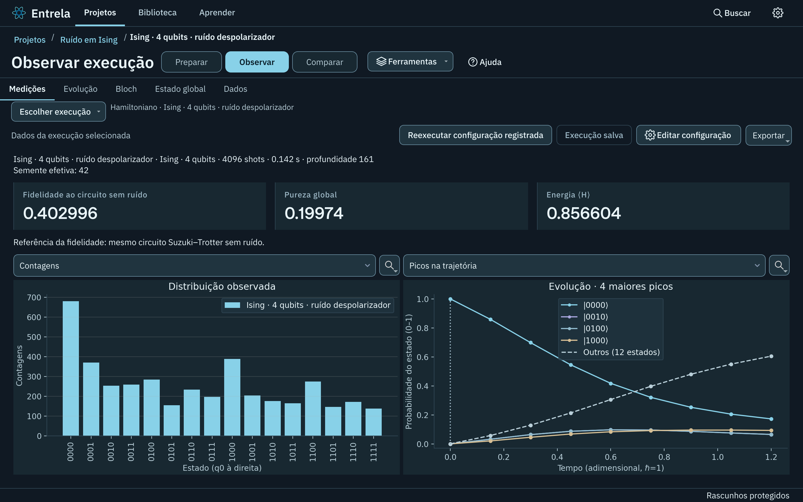
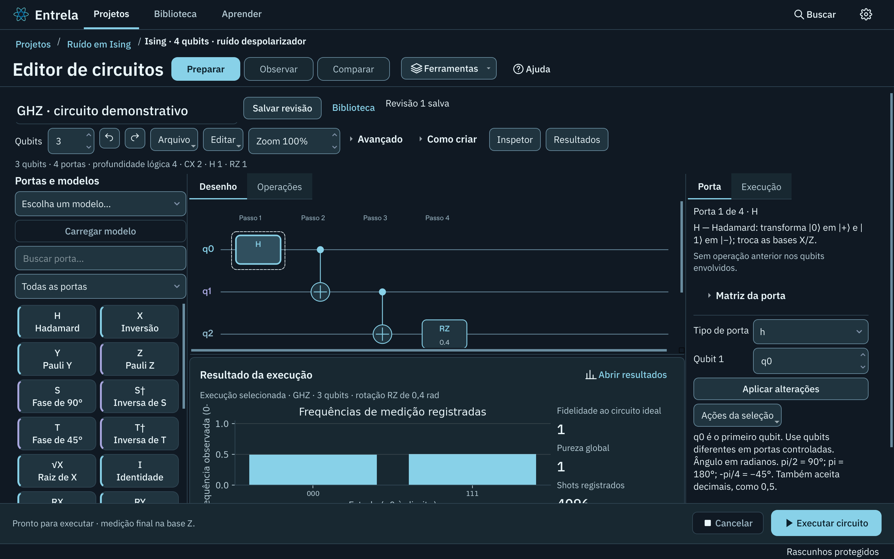
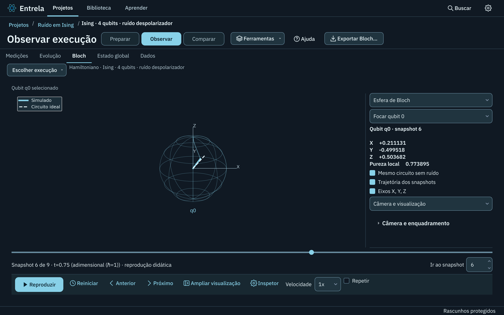
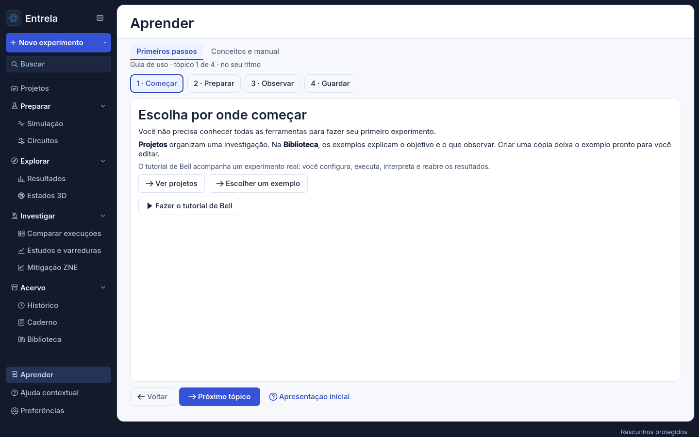

# Entrela

**Preparar. Observar. Comparar.**

O Entrela é um laboratório de simulação quântica para construir circuitos,
acompanhar estados e investigar os efeitos do ruído. Você pode começar por um
exemplo, preparar seu próprio experimento e comparar os resultados sem perder
as configurações usadas em cada execução.

**[Baixar o Entrela para Windows](https://github.com/ShardGem/Entrela/releases/download/v0.27.0/Entrela-0.27.0-windows-x64-setup.exe)** ·
[Versão portátil](https://github.com/ShardGem/Entrela/releases/download/v0.27.0/Entrela-0.27.0-windows-x64-portatil.zip) ·
[Ver a galeria](docs/screenshots/0.27.0/README.md) ·
[Conhecer esta versão](https://github.com/ShardGem/Entrela/releases/tag/v0.27.0)

## Do circuito ao resultado

Escolha uma configuração pronta ou monte uma investigação do início. A preparação
pode ser guiada, com explicações em cada etapa, ou reunir todos os parâmetros para
quem já sabe o que deseja testar. Alternar entre os modos preserva seu rascunho.

Na bancada, você pode:

- Construir circuitos com portas quânticas, inspecionar cada operação e guardar
  revisões para continuar depois.
- Simular a evolução por Hamiltonianos, como Ising, com aproximações de
  Suzuki–Trotter de segunda ou quarta ordem.
- Comparar a execução sem ruído com modelos de despolarização ou relaxamento
  térmico, ajustando os parâmetros do experimento.
- Consultar contagens, frequências, probabilidades calculadas, fidelidade,
  pureza e energia, com a referência de cada medida identificada.
- Investigar a convergência, variar parâmetros e explorar estimativas de
  observáveis por extrapolação de ruído zero, a ZNE.

O editor inclui busca de portas, modelos, copiar e colar, desfazer e refazer,
zoom e importação ou exportação de circuitos em JSON e OpenQASM 2.

## Veja o estado quântico evoluir

Percorra os snapshots calculados, pause a reprodução e escolha um qubit para
examinar seus componentes X, Y e Z. A esfera de Bloch mostra o estado local;
o inspetor do estado global permite consultar a matriz densidade e distinguir
pureza local de pureza global.

Nas comparações, distribuições, curvas e métricas usam as execuções escolhidas.
Quando os registros permitem, o Bloch lado a lado sincroniza os snapshots e as
câmeras para acompanhar os dois resultados.

## Uma investigação que você pode retomar

Os projetos reúnem experimentos, anotações e evidências. O histórico permite
reabrir uma execução, consultar o circuito e reutilizar seus parâmetros como
base para um novo trabalho. Editar um rascunho preserva os resultados anteriores.

O caderno ajuda a registrar a pergunta, a hipótese, o método e a interpretação.
Para documentar o estudo, exporte dados em **CSV e JSON**, figuras em
**PNG, SVG e PDF**, animações em **GIF** ou um **relatório científico A4**.
O pacote ZIP reúne dados e artefatos com as fontes identificadas.

## Para começar

No Windows, [baixe o instalador](https://github.com/ShardGem/Entrela/releases/download/v0.27.0/Entrela-0.27.0-windows-x64-setup.exe)
e siga a instalação. **Não precisa instalar Python.** A distribuição é para
Windows 10 21H2 ou posterior e Windows 11, em computadores x64.

Na primeira abertura, uma apresentação opcional oferece caminhos para conhecer
o aplicativo, explorar exemplos ou fazer o tutorial de Bell. Você pode dispensá-la
e voltar ao guia em **Aprender → Primeiros passos** quando quiser.

Temas claro, grafite e azul, tamanho de texto, densidade e redução de movimento
podem ser ajustados nas Preferências.

## Sobre o projeto

O Entrela nasceu como um Trabalho de Conclusão de Curso em Ciência da Computação
e segue em desenvolvimento. Os resultados são produzidos por simulação clássica
de sistemas quânticos. A ZNE estima observáveis; não reconstrói um estado mitigado
nem garante melhoria em todos os cenários.

As capturas mostram configurações de demonstração calculadas pelo aplicativo.
A [galeria](docs/screenshots/0.27.0/README.md) reúne mais telas e identifica os
cenários utilizados.

---

Feito com **Python, PySide6, Qiskit e Aer**.
[Arquitetura e fluxo de trabalho](docs/interface-0.27.md) ·
[Convenções e limites científicos](docs/evolucao-0.14.md) ·
[Compilação para Windows](docs/compilar-windows.md) ·
[Relatar um problema](https://github.com/ShardGem/Entrela/issues)
