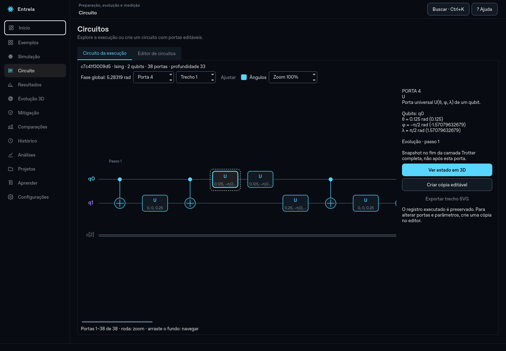
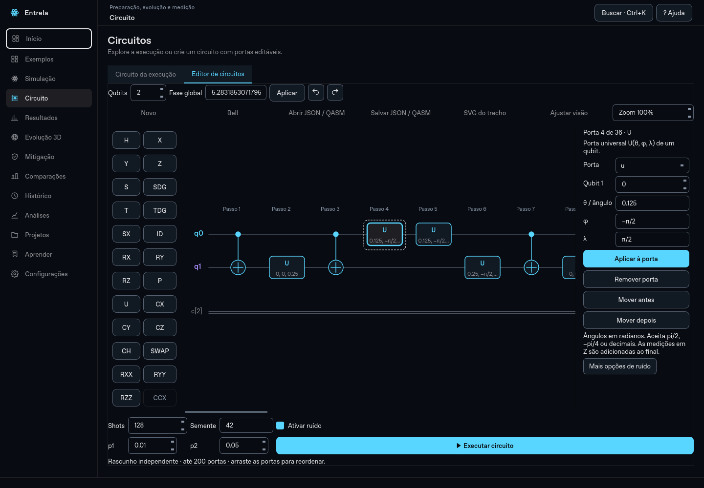
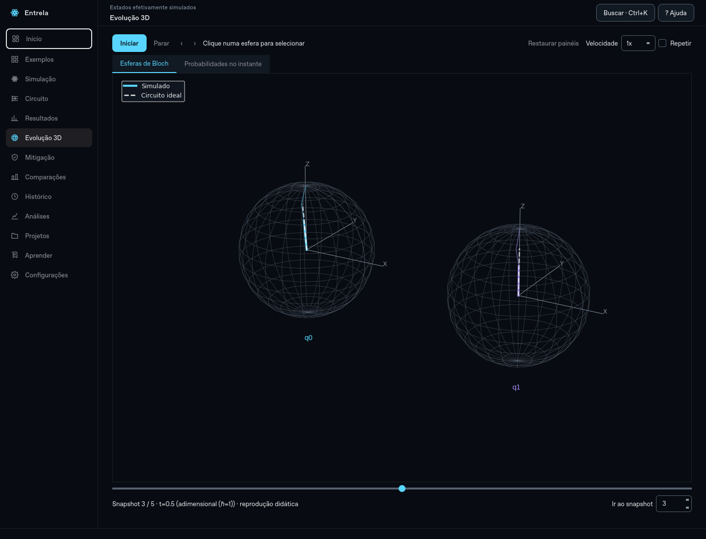

# Entrela 0.12 — circuitos interativos e inspeção 3D

A tela de circuitos usa **Qt Graphics View (PySide6)** para desenho, seleção e edição, e **Qiskit/Aer** para construir e simular as operações. O diagrama da interface deixou de ser ASCII. As bibliotecas já fazem parte do projeto; não é necessário instalar um serviço web ou outra aplicação.

## Circuito da execução

A aba **Circuito da execução** mostra portas, linhas de qubits, controles/alvos, parâmetros e medições. Clique numa porta para consultar seu significado, os valores exatos dos ângulos e a origem na execução. A fase global fica explícita, com precisão adicional no tooltip.

- Roda: zoom; arraste o fundo para navegar. O controle numérico de zoom e **Ajustar** também estão disponíveis.
- **Porta**: navega diretamente por índice. **Trecho**: pagina circuitos longos, com até 100 operações por trecho.
- **Ângulos**: alterna rótulos compactos; o inspetor mantém os valores completos.
- **Ver estado em 3D**: abre o snapshot correspondente. Em Suzuki–Trotter é o fim da camada inteira. Na medição final, o estado mostrado é o anterior à medição, sem inventar um estado condicionado ao resultado.
- **Criar cópia editável**: copia as portas e a fase para o editor, preservando o registro original. Shots, semente efetiva e modelo de ruído também são copiados.
- **Exportar trecho SVG**: gera desenho vetorial do trecho exibido, com descrição de proveniência.

O diagrama sempre usa as operações registradas quando disponíveis. Para registros antigos sem essas operações, a reconstrução pela configuração é identificada. O texto legado permanece apenas nos arquivos antigos e no pacote de exportação para compatibilidade.

## Editor de circuitos

A aba **Editor de circuitos** mantém um rascunho independente. Comece por **Bell**, **Novo** ou por uma cópia da execução.

1. Escolha a quantidade de qubits e a fase global.
2. Clique numa porta da paleta para inseri-la após a seleção, ou no final quando não houver seleção.
3. Selecione a porta no desenho. Ajuste o tipo, os controles/alvo e seus ângulos no inspetor; clique em **Aplicar à porta**.
4. Arraste horizontalmente para reordenar, ou use **Mover antes/depois**. Remova portas e use desfazer/refazer (Ctrl+Z / Ctrl+Y).
5. Defina shots, semente e ruído. **Mais opções de ruído** permite escolher despolarização ou relaxamento térmico T₁/T₂. O limite T₂ ≤ 2T₁ continua sendo validado.
6. Clique em **Executar circuito**. A execução roda em segundo plano, gera outro registro e disponibiliza contagens, estados, Bloch, fidelidade e pureza no fluxo normal do aplicativo.

A paleta oferece H, X, Y, Z, S, S†, T, T†, SX, identidade, RX, RY, RZ, P, U, CX, CY, CZ, CH, SWAP, RXX, RYY, RZZ e CCX. Há ajuda em português para cada porta e identificação dos controles/alvo. Ângulos aceitam números, `pi/2`, `−π/4` e aritmética simples. A entrada não executa Python.

**Limites explícitos:** 1–6 qubits, até 200 portas no documento editável, portas unitárias e medição de todos os qubits em Z ao final. O diagrama da execução pode inspecionar circuitos maiores por trechos. Medições intermediárias, reset e controle clássico condicionado não fazem parte deste editor. CH e portas de três qubits são decompostas em U/CX antes da simulação, preservando o vínculo entre operações nativas e porta lógica; o ruído incide nessas operações efetivamente executadas.

### Arquivos e fase global

**Salvar/Abrir JSON** preserva o documento completo, incluindo fase global e parâmetros. A importação/exportação **OpenQASM 2** é validada; instruções fora das capacidades do editor são rejeitadas com mensagem. OpenQASM 2 não define a fase global do circuito: o Entrela registra essa informação em comentário próprio e a restaura quando lê seus arquivos. Outros leitores podem ignorar esse comentário.

A fase global é preservada no operador, embora isoladamente não altere probabilidades. O exemplo de circuito Suzuki–Trotter de dois qubits foi verificado contra a execução e preserva a fase 2π−1 ≈ 5,2832 rad ao criar a cópia editável.

Os experimentos de circuito livre usam **JSON de experimento versão 3**. Isso impede que um leitor antigo interprete silenciosamente essas portas como uma evolução Ising. Registros anteriores das versões 1/2 continuam legíveis, e novas execuções de Hamiltoniano mantêm o formato versão 2.

### Interpretação científica

O circuito livre começa em |0…0⟩, aplica as portas do documento e mede todos os qubits. O eixo dos snapshots é o **índice da porta lógica**, sem tempo físico definido. Os snapshots precedem a medição final.

A fidelidade compara o mesmo circuito sem ruído; pureza é calculada sobre o estado. Não há energia nem referência exp(−iHt) sem definir um Hamiltoniano: esses campos ficam ausentes. Convergência Trotter e varreduras de J/h/passos não se aplicam a esse tipo de registro. As análises temporais de estado e varreduras de ruído continuam disponíveis. Comparações entre registros verificam também o documento de circuito.

## Ajustes na visualização 3D

- **Ampliar área 3D** oculta os painéis, matrizes e cabeçalho da página; **Restaurar painéis** ou Esc recupera o layout. A câmera e o snapshot são preservados.
- Clique numa esfera para selecionar e destacar o qubit, sem mover a câmera. Seus dados locais ficam destacados. **Focar selecionado** isola sua esfera. Clicar no fundo não altera a seleção.
- **Shift + arraste esquerdo** move a cena, sem rotação simultânea. O botão central continua disponível.
- **Calcular métricas** obtém os dados em segundo plano e mostra F, pureza e energia do snapshot. Em **Gráfico**, o cursor acompanha o slider; clicar num instante da curva seleciona o mesmo snapshot em 3D e na análise. Para circuito livre, energia não é inventada.

## Validação

215 testes passaram localmente no Linux/Python 3.12, incluindo os 160 anteriores e 55 novos testes de circuito/gestos/métricas. Foram verificados:

- Todas as 24 portas do editor contra o estado calculado independentemente pelo Qiskit, incluindo a fase global.
- Cópia do circuito Trotter e preservação de seu operador/fase, ruído em portas de três qubits, estados e contagens reproduzíveis.
- JSON/QASM, esquema versão 3, reabertura do registro, SVG vetorial, clique/arraste reais no Qt, undo/redo e execução pelo editor.
- Seleção de qubit sem movimento de câmera, fundo sem seleção, Shift-pan, ampliação/restauração e cursor temporal bidirecional.
- Fluxo completo do aplicativo, sondagem 3D em escala 150% e wheel executado fora do checkout.

As capturas mostram a aplicação real. Também foi feita inspeção em 1024×768. A matriz de CI mantém Linux/Python 3.12 e Windows/Python 3.14 com escala 150%; ensaio físico com touchpad/projetor continua recomendado antes da apresentação.
