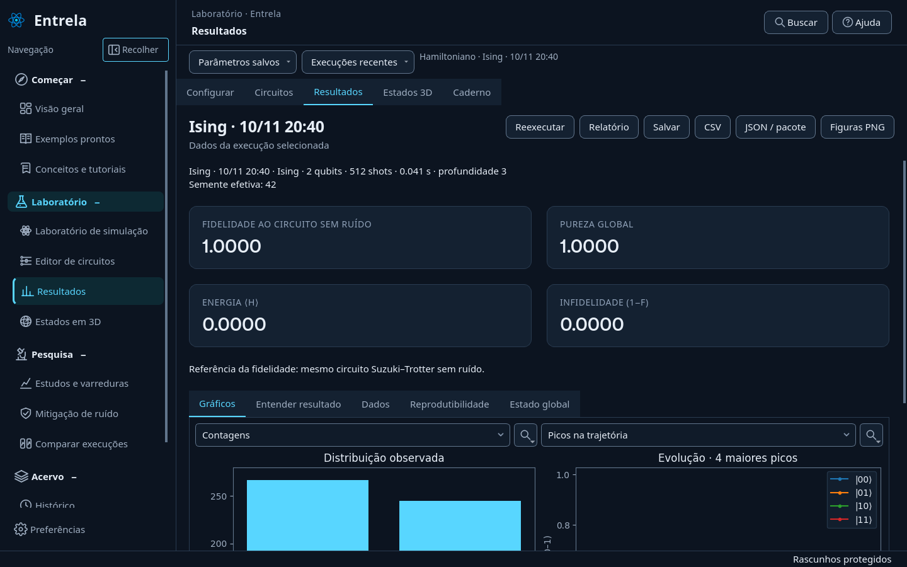
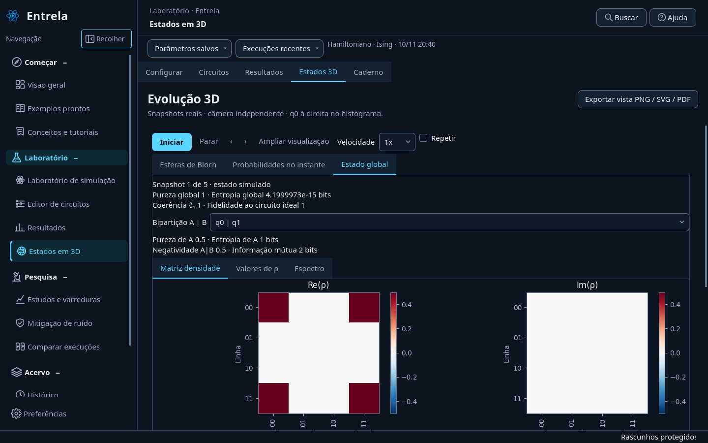
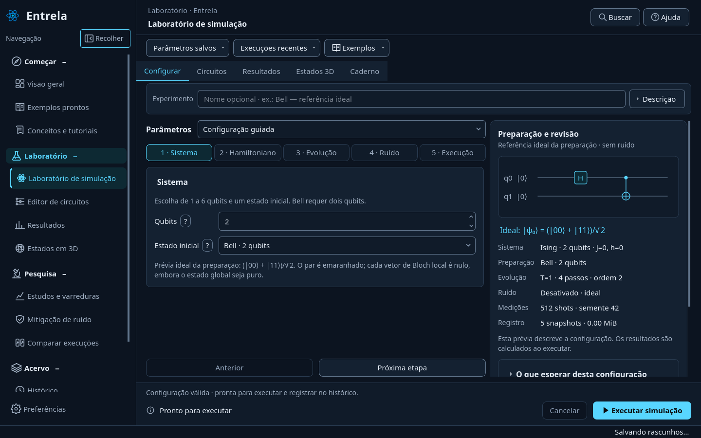
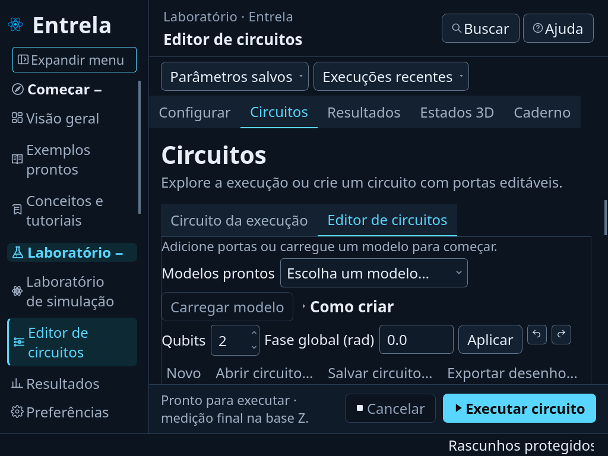

# Entrela 0.20 — confiabilidade e interpretação

Esta entrega inicia o [plano completo por prioridade](plano-evolucao.md). O foco é corrigir interpretações visuais, preservar dados e tornar as operações existentes mais acessíveis. A splash restaurada, a identidade visual, os grupos abertos e os nomes no menu estreito foram preservados.

## O que mudou e como usar

### Comparações e gráficos

Histogramas de execuções diferentes usam frequência observada e a mesma escala vertical de 0 a 1,05. O denominador é o total observado em cada execução: 50% tem metade da altura de 100%, mesmo quando as execuções usam quantidades diferentes de shots. Frequência amostrada não equivale à probabilidade exata do estado.

Em **Resultados → Gráficos**, a distribuição continua começando em contagens; o seletor permite mudar para frequência. A evolução seleciona até quatro estados com os maiores picos de toda a trajetória. É possível escolher o critério final ou selecionar estados manualmente. **Outros** soma a probabilidade dos estados omitidos; não representa um estado computacional adicional.

Os controles compactos de exploração permitem ampliar, mover e restaurar os eixos. Tooltips apresentam valores mais precisos. As fontes dos gráficos Qt acompanham a preferência da interface; os gráficos científicos portáveis mantêm seu próprio estilo.

### Incerteza na mitigação

ZNE mantém os estimadores, ajustes e erros padrão existentes. Acrescenta intervalos binomiais de Wilson aproximados de 95% para o observável Z em cada fator de ruído. Poucos shots e amostras sem variação geram orientações explícitas.

Um erro padrão plug-in igual a zero pode resultar de uma amostra insuficiente: não comprova certeza. Os intervalos por fator não são intervalos do alvo extrapolado e não cobrem automaticamente viés de ajuste, erro do modelo nem comparações múltiplas. Os metadados ficam preservados nas análises/exportações; no benchmark, informações por método ficam separadas das colunas tabulares.

### Estado global e diagnóstico da configuração

**Resultados → Estado global** inspeciona o estado final, inclusive sem snapshots. **Estados 3D → Estado global** acompanha o snapshot selecionado usando os estados já calculados. A renderização é adiada enquanto o inspetor está oculto, e a tabela de valores é preenchida quando solicitada.

O inspetor mostra Re(ρ), Im(ρ), valores complexos, espectro, pureza global, entropia em bits, fidelidade à referência disponível e coerência ℓ₁ na base computacional. A coerência não é normalizada: depende da base e da dimensão do sistema. É possível escolher o subsistema A e consultar sua pureza, entropia, negatividade A|B e informação mútua. Negatividade zero não prova separabilidade em geral.

Bell ideal ilustra a distinção: pureza global 1, entropia global 0 e pureza local ½. Uma mistura clássica 00/11 pode ter a mesma pureza local, mas possui pureza global ½ e entropia global de 1 bit. Os dados do inspetor vêm do simulador; não são tomografia experimental.

Na revisão da configuração, **O que esperar desta configuração** explica casos como Hamiltoniano nulo, autoestado, termos comutantes e populações constantes em Z. As orientações descrevem as condições da evolução ideal e explicitam os limites da aproximação e do ruído. Nenhum desses casos válidos é bloqueado.

### Execução e editor

O monitor da tarefa atual permanece acessível ao navegar entre páginas e usa o progresso real do worker. O cancelamento é cooperativo: espera a etapa em andamento. Durante a gravação final, informa **Salvando resultado** e evita interromper a preservação do registro.

O editor mantém os controles de executar/cancelar fora da rolagem. A biblioteca de portas pode ser filtrada por texto ou categoria. **Operações** apresenta uma alternativa textual sincronizada com a seleção do desenho, incluindo seleção por teclado, copiar/colar e precisão dos parâmetros. Desfazer, refazer, revisões, importação e recuperação de rascunhos foram mantidos.

### Histórico, tutorial e preservação

- O projeto selecionado usa um filtro exato e removível, independente da busca livre. Citar outro projeto em observações não inclui a execução naquele agrupamento.
- Retomar o tutorial reabre a execução armazenada. A etapa de interpretação verifica a identidade realmente exibida, e suas ações levam a Resultados ou Histórico conforme a etapa.
- Caches de resumo inválidos são descartados e reconstruídos pela fonte, sem esconder registros íntegros nem alterar seus arquivos.
- A biblioteca pessoal usa bloqueio local sobre toda a operação de ler, alterar e salvar, inclusive na importação de estudos. Gravações concorrentes são serializadas ou recebem um diagnóstico de tempo de espera.
- Comparações de circuitos livres ignoram campos de Hamiltoniano que não participam da execução; diferenças físicas pertinentes continuam sendo verificadas.

## Backup completo

Em **Preferências → Backup do espaço de trabalho**, crie um ZIP fora da pasta dos dados. Ele inclui os arquivos locais de experimentos, circuitos, anotações, análises, protocolos, rascunhos e preferências. Locks e pastas transitórias de importação/restauração são excluídos.

Para restaurar, selecione um backup completo. A aplicação verifica o manifesto, os tamanhos, os hashes SHA-256 e os caminhos antes de apresentar a prévia. O usuário confirma a substituição do espaço atual; não é uma mesclagem. A janela é reaberta para recuperar as fontes e preferências pelo fluxo normal de inicialização.

O trabalho atual deve ser salvo em outro backup antes da substituição. Feche outras instâncias que usem a mesma pasta. A janela mantém seus gravadores parados durante a operação; isso não constitui coordenação multiusuário. Há limites de 20.000 arquivos e 2 GB, além de rejeição de links e caminhos incompatíveis com Windows.

Uma falha de instalação tenta restaurar a pasta anterior. Se o próprio rollback falhar, a cópia de recuperação é preservada e seu caminho é informado. Hashes verificam integridade de transporte, não correção científica: fontes corrompidas também são preservadas em bytes para diagnóstico.

## Validação e limites

A validação inclui testes analíticos de Bell, mistura clássica e GHZ; escalas e conservação da probabilidade; ZNE com poucos shots; corrupção de cache; concorrência real entre processos; restauração, cancelamento, caminhos inseguros e rollback. Os fluxos Qt usam execução offscreen no ambiente Linux. Capturas verificam também o editor em 1024 × 768 com fonte de 24 px.

A suíte geral passou com **605 testes**. Após um reforço no tratamento de falha do rollback, os **5 testes de integração do backup** passaram novamente, incluindo o novo caso que mantém os gravadores suspensos quando a pasta exige recuperação manual. A incompatibilidade de metadados tabulares do benchmark foi corrigida mantendo os diagnósticos por método fora das colunas. Os registros de validação ficam em `work/validacao-020/` no ambiente de execução.

O wheel é conferido contra os arquivos Python da fonte e aberto em um processo isolado, fora do repositório. O teste do laboratório percorre as 14 páginas, simula casos ideais/ruidosos com e sem snapshots e verifica persistência, ZNE e tutorial. Não foi realizada validação manual nativa no Windows nesta sessão; a CI existente continua sendo uma verificação adicional.

Campanhas recuperáveis, preparação por circuito seguida de evolução por Hamiltoniano, observáveis gerais/energia com ZNE, projetos como coleções de evidências e instalador Windows permanecem no plano de próximas entregas. Esta versão não afirma concluir todas as propostas do plano.
