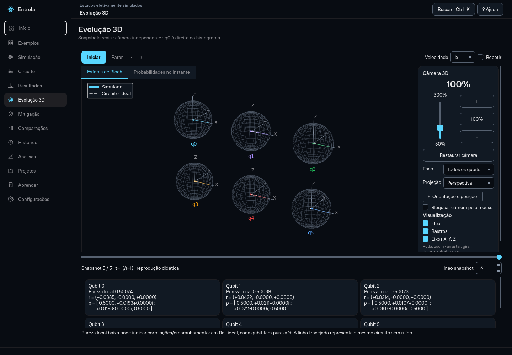

# Correção do fechamento e controles da visualização 3D

A tela 3D passou a usar um tamanho sugerido estável para o layout Qt. Isso interrompe o ciclo em que o canvas, ao ser redimensionado, alterava sua própria sugestão de tamanho e provocava outro redimensionamento. O problema podia parecer um zoom contínuo, deslocar a cena e terminar em falha nativa. A atualização também acrescenta um painel lateral com zoom vertical e controles de câmera.



## Atualizar no Windows

Feche o aplicativo e execute na pasta do projeto:

```powershell
git fetch origin
git switch evolucao-entrela
git pull --ff-only
.\.venv\Scripts\python.exe app.py
```

Não é necessário apagar experimentos nem preferências. Valores antigos de câmera são validados e limitados ao restaurar a sessão.

## Controles disponíveis

| Controle | Comportamento |
|---|---|
| Slider vertical | Zoom entre 50% e 300%; a porcentagem acompanha também a roda e os botões. |
| +, − e 100% | Aproximar, afastar ou retornar ao zoom original. |
| Restaurar câmera | Restaura zoom, centro, orientação e perspectiva, mantendo o qubit selecionado. |
| Foco | Mostra todos os qubits ou isola um deles, incluindo os dados locais. |
| Perspectiva / Ortográfica | Alterna o tipo de projeção. |
| Orientação e posição | Expande controles de elevação/azimute, vistas 3D/Frente/Topo e deslocamento. |
| Centralizar (◎) | Remove deslocamento sem alterar zoom ou orientação. |
| Bloquear câmera pelo mouse | Impede mudanças por arraste ou roda; os controles do painel continuam disponíveis. |
| Ideal, Rastros, Eixos | Alterna a referência ideal, os rastros reais e os eixos XYZ. |
| Ir ao snapshot | Seleção numérica sincronizada com a linha do tempo, inclusive durante reprodução. |

A roda só controla a câmera quando está sobre a área do gráfico. Deltas de touchpad são normalizados e eventos extremos são limitados. Arrastar com o botão esquerdo gira; o botão central move. Deslocamento e zoom têm limites. Ao sair da página, a reprodução é pausada.

A câmera fica separada dos estados quânticos. Atualizar snapshots ou redesenhar a tela não altera zoom, orientação nem centro. Os controles usam bloqueio de sinais durante a sincronização para evitar realimentação. Posição, zoom, orientação e projeção persistem ao fechar e reabrir.

## Evidência e validação

O log recebido do Windows/Python 3.14 apontava `Windows fatal exception: stack overflow`, no loop de eventos Qt, sem uma função Python causadora. O aviso anterior de fonte não identificava essa causa.

Uma sondagem com a tela 3D em 1024×768 reproduziu uma falha nativa também no Linux. No mesmo cenário, restaurar o `sizeHint` original do Matplotlib para o canvas de Bloch manteve a falha; usar a sugestão de tamanho estável eliminou o fechamento e manteve tamanho/projeção constantes durante a ociosidade. A mudança foi aplicada também aos demais canvases incorporados.

Validação local: **151 testes passaram** no Linux/Python 3.12, incluindo 18 novos casos de câmera e layout. A verificação que antes encerrava o processo agora roda em subprocessos com escalas 100%, 125%, 150% e 200%, usando 1, 2 e 6 qubits, alternância de páginas/abas, redimensionamento e reprodução. Os testes verificam tamanho estável, ausência de movimento espontâneo, limites, sinais, input Qt de touchpad, isolamento do qubit, persistência e preservação dos estados científicos.

O fluxo completo do aplicativo e o wheel fora do checkout também passaram. A matriz de CI agora inclui Windows/Python 3.14 com escala 150%, além de Linux/Python 3.12. Uma execução offscreen não substitui a verificação no computador e no touchpad usados na apresentação.

Para executar somente a sondagem gráfica:

```powershell
$env:QT_SCALE_FACTOR = "1.5"
.\.venv\Scripts\python.exe -X faulthandler scripts/bloch_smoke.py
```

O arquivo `logs/entrela-crash.log` agora registra versões de Python, sistema, Qt, Matplotlib, NumPy e Qiskit para auxiliar investigações adicionais.
