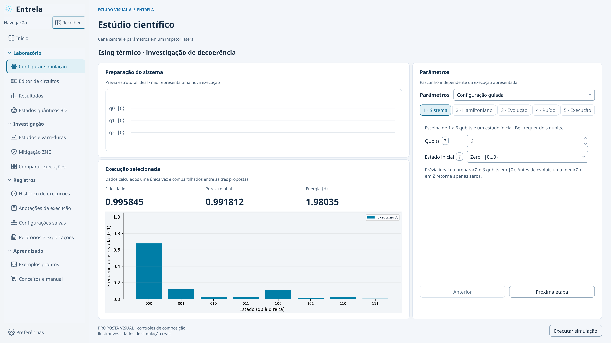
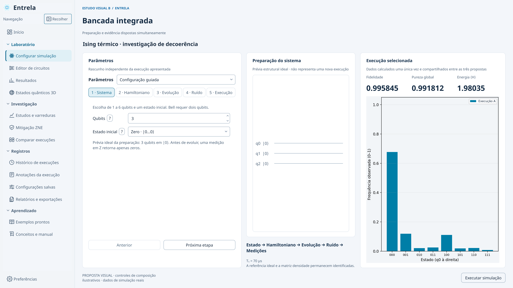
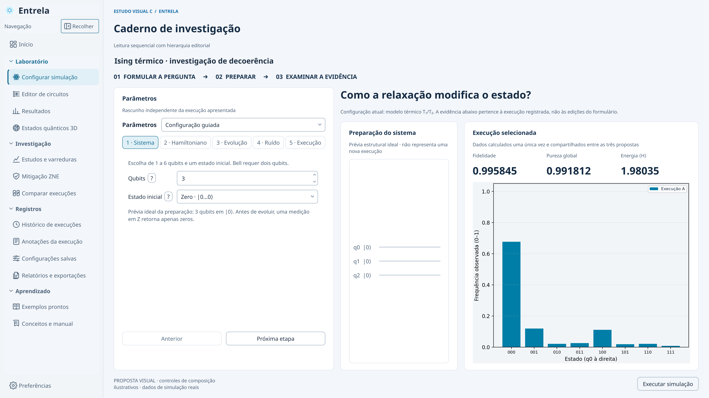

# Direção visual do Entrela 0.25

A revisão começou pela arquitetura existente: PySide6, 14 páginas, componentes compartilhados, coordenação em `MainWindow`, simulação em Qiskit/Aer e persistência separada da interface. Não havia motivo para substituir o simulador, o editor versionado ou os formatos dos experimentos.

O problema principal era a composição. Várias barras de navegação apareciam antes da área científica; parâmetros, explicações e resultados disputavam a mesma hierarquia; o editor colocava quase todo o trabalho em uma sequência vertical. Recolorir os mesmos cartões manteria esses problemas.

## Arquitetura e dependências examinadas

| Camada | Componentes existentes | Decisão e risco considerado |
|---|---|---|
| Simulação e análise | `core`, Qiskit, Aer, NumPy e SciPy | Preservar cálculos e referências; uma mudança visual não pode alterar estados, ângulos ou parâmetros efetivos |
| Persistência | `data/repository.py`, `workspace.py`, `drafts.py`, bibliotecas de circuitos, análises e protocolos | Reutilizar os contratos atuais; não criar outra fonte de verdade para nomes, configurações ou resultados |
| Coordenação e navegação | `gui/main_window.py`, controladores, 14 páginas e espaços de trabalho | Preservar os acessos diretos; reduzir controles locais repetidos sem esconder funcionalidades |
| Circuitos | Documento do circuito, pilha de desfazer, canvas, lista de operações e biblioteca versionada | Reposicionar os mesmos widgets; testar seleção, precisão, teclado e restauração ao alternar a disposição |
| Apresentação | PySide6, temas, preferências, componentes compartilhados e Matplotlib | Centralizar superfícies e hierarquia; conferir contraste, escala de texto, áreas mínimas e atualização dos temas |
| Distribuição e documentação | `pyproject.toml`, recursos do aplicativo e scripts de captura/verificação | Conferir assets e módulos dentro do wheel; registrar dimensões, cenários e hashes das capturas |

Não foram adicionadas dependências. As versões usadas nas capturas estão no manifesto da galeria. A coordenação em `MainWindow` continua extensa e sua extração gradual permanece no plano; esta entrega não tenta resolver esse acoplamento enquanto modifica a composição visual. A restauração da geometria da preparação recebe uma migração específica, pois os lados do painel trocaram de função.

## Três composições com a mesma simulação

As imagens abaixo são **estudos de composição em Qt**, com controles ilustrativos. Não são capturas de funcionalidades novas. Os valores vêm de uma execução real do exemplo Ising com ruído térmico, registrada em [cenario.json](cenario.json). São dados simulados para avaliar a interface, sem representar medições físicas ou resultados do TCC.

| Proposta | Organização | Vantagem | Limite |
|---|---|---|---|
| A · Estúdio científico | Área científica central, parâmetros à direita e execução na base | Valoriza a visualização e mantém a configuração próxima | Exige reorganização em abas nas janelas menores |
| B · Bancada integrada | Configuração, cena e evidências em três colunas | Permite consultar várias etapas simultaneamente | Reduz a largura dos gráficos e exige mais espaço horizontal |
| C · Caderno de investigação | Protocolo e evidências em uma sequência editorial | Favorece leitura e documentação do estudo | A configuração pode exigir mais rolagem durante ajustes repetidos |

### A · Estúdio científico — direção adotada



### B · Bancada integrada



### C · Caderno de investigação



## Decisão

O estúdio científico oferece o melhor equilíbrio para configurar, executar e interpretar simulações. A implementação adapta essa direção a cada ferramenta: paleta/desenho/inspetor no editor, lista/detalhe nos exemplos e histórico, categorias/formulário nas preferências e transporte abaixo da cena 3D. As outras duas propostas ficam documentadas para comparação; não são três modos de navegação adicionados ao produto.

Os estilos Grafite, Claro científico e Azul escuro continuam disponíveis. A identidade usa os arquivos enviados pelo autor em `5dfe5c3`; a splash e suas imagens não foram redesenhadas nesta etapa.

A [galeria da implementação](../../screenshots/0.25.0/README.md) mostra as telas reais. O [registro da entrega](../../interface-0.25.md) descreve mudanças, verificações e limites.

Para reproduzir os estudos, em uma instalação com as dependências do projeto:

```bash
python scripts/design_proposals.py
```
