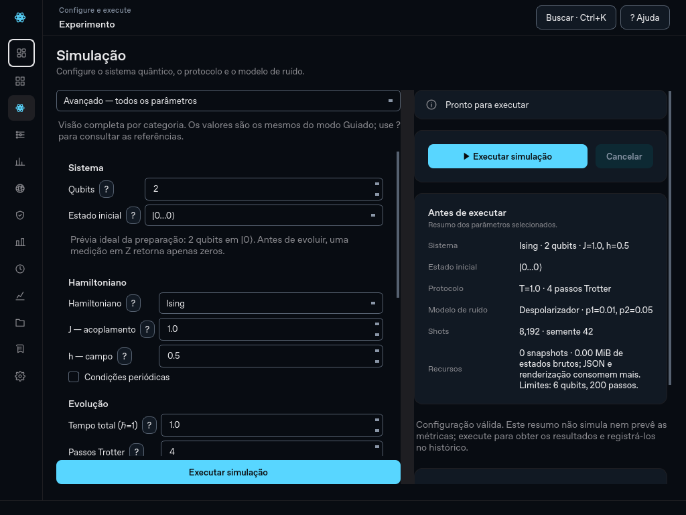
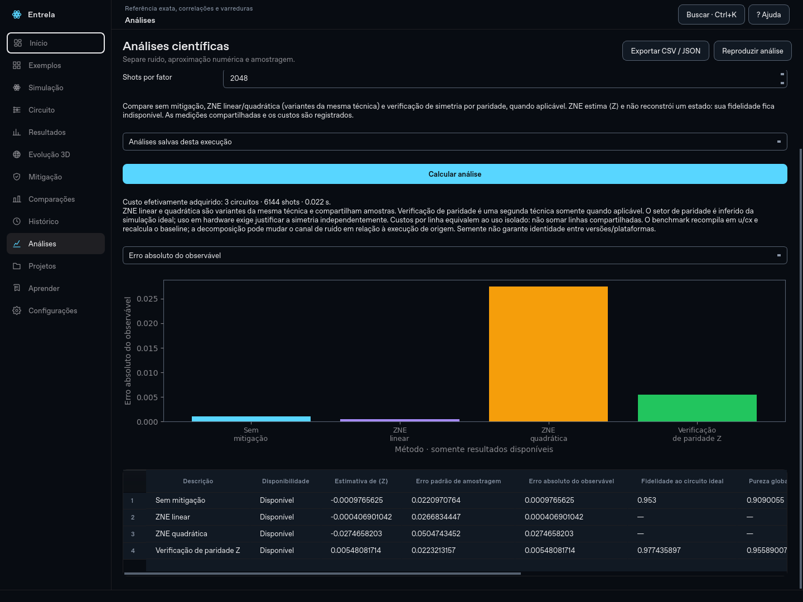

# Entrela 0.13 — pesquisa reproduzível e experiência de uso

Base: `e193fff`, versão 0.12 da branch remota `evolucao-entrela`. Esta entrega foi desenvolvida na branch `evolucao_entrela`, com o nome solicitado. A base original passou nos 215 testes antes da integração.


## Começar e organizar

O Início apresenta o ciclo configurar → executar → inspecionar → comparar/exportar, com conceitos introdutórios opcionais. Guiado mostra uma categoria por vez. Avançado exibe as categorias e oculta os controles de navegação guiada; voltar ao Guiado mantém a etapa selecionada e todos os valores. Campos têm ajuda em português, e o estado inicial tem prévia descritiva ideal: não é uma simulação de ruído nem uma previsão da dinâmica.

Na página Projetos, nomeie a execução selecionada, indique projeto, tags e observações. A configuração do formulário pode ser salva separadamente como modelo pessoal. Nome e anotações ficam no workspace; o ID técnico e o registro científico continuam preservados. Histórico, comparações, início e relatório mostram nomes amigáveis; o ID continua pesquisável e aparece nos detalhes.



## Estudo Trotter × ruído

Abra uma execução por Hamiltoniano, vá a Análises e selecione **Trotter × ruído: estudo pareado**. Informe de um a dez valores inteiros distintos entre 1 e 200. Para cada passo, são calculadas duas execuções com o mesmo tempo final, ordem Suzuki e semente efetiva: sem ruído e com o ruído configurado na fonte. A referência é `exp(−iHt)` aplicada ao estado inicial ideal.

A curva ideal compara aproximação Trotter com evolução exata; a ruidosa inclui os dois efeitos, sem presumir uma decomposição aditiva dos erros. A análise registra fidelidades, pureza, energia, profundidade, portas e tempos. O melhor ponto é somente o melhor entre os valores calculados, não um ótimo global. Se o ruído da fonte estiver desligado, isso é informado e as curvas coincidem.

Fidelidade/pureza do ensemble não ganham uma barra de erro por variar seeds ou repetir a mesma seed. Contagens têm flutuação de amostragem. Tempos de execução medem esta máquina e incluem custos de execução, não uma estimativa de latência em hardware quântico.

## Benchmark de mitigação

Abra uma execução concluída, escolha **Benchmark de mitigação**, qubit de Z e shots por fator. O estudo usa:

1. Sem mitigação: referência experimental ruidosa, com ⟨Z⟩ amostrado e métricas do ensemble.
2. ZNE linear e quadrática: duas variantes da mesma técnica, fatores 1, 3 e 5.
3. Verificação de simetria por paridade Z: segunda técnica, disponível somente quando o estado ideal tem paridade Z determinística. Se não se aplica ou nenhum shot é aceito, o resultado mostra a razão.

O circuito inteiro é compilado uma vez em U/CX antes do folding; os pares `U†U` preservam a operação ideal. Não há otimização depois do folding. Todos os métodos usam a mesma base compilada e o mesmo modelo de ruído. Por isso o baseline é recalculado e pode diferir do registro de origem: a decomposição altera as operações nas quais o ruído incide. Não se compara silenciosamente dois canais de ruído diferentes.

Os ajustes reutilizam exatamente as mesmas medições. Cada linha mostra custo equivalente ao método isolado; não se somam linhas com amostras compartilhadas. O resumo mostra o custo realmente adquirido. Aquisição e processamento são registrados separadamente. Não se promete orçamento igual entre técnicas: ZNE usa mais circuitos, enquanto pós-seleção descarta amostras.

ZNE fornece estimativa e erro absoluto de ⟨Z⟩ contra a referência ideal compilada, não matriz densidade mitigada. Fidelidade, pureza e energia de ZNE ficam ausentes. O erro padrão propagado cobre amostragem sob o ajuste, não viés de extrapolação; três pontos em ajuste quadrático têm zero grau de liberdade residual. Resultados fora do intervalo físico não são truncados e ausência de melhoria é preservada.

Na verificação de paridade, as métricas de estado são da matriz densidade condicionada simulada, não reconstruídas das contagens em Z. A fração de shots aceita é amostral; a probabilidade de aceitação do ensemble é registrada separadamente. O setor é inferido da simulação ideal e, para aplicação a hardware, precisaria de uma simetria justificada independentemente. Essa seleção não detecta todo tipo de erro.

Limites: 1–6 qubits; até cinco fatores distintos, ímpares de 1 a 9, incluindo 1; no máximo 100.000 portas por circuito folded e 1.000.000 shots por fator. A interface usa 1/3/5. Cancelamento é cooperativo entre operações Aer, sem encerrar threads à força.



## Reprodução e exportação

Cada simulação registra configuração completa, seed solicitada e efetiva, método Aer, versões, plataforma, convenções e operações. A análise ZNE registra também circuito compilado, fatores, contagens e seed por fator. Benchmark registra configurações, ajustes, estado baseline, pós-seleção e fingerprint dos inputs. O estudo pareado guarda configurações, contagens e versões por execução.

As análises são gravadas atomicamente em `.analyses/<id da fonte>/`, separadas do experimento. Abra a fonte pelo Histórico e escolha uma análise salva. **Reproduzir análise** executa novamente com as opções registradas; tempos e identificadores novos naturalmente variam. Em registros com ZNE, **Reproduzir ZNE** recalcula a análise com método, qubit, fatores, shots e seed registrados, preservando as métricas da fonte. Reabrir o registro também restaura os controles de mitigação. Seeds não garantem resultados idênticos entre versões ou plataformas.

- **CSV de resultados:** inclui ID, nome, timestamp, seed efetiva, configuração, metadados, mitigação, métricas e contagens. Estados complexos completos ficam no JSON.
- **CSV de análise:** tabela e arquivo adjacente `.metadata.json`, com configuração, versões, medições e demais dados de proveniência. Preserve ambos.
- **JSON de análise:** artefato completo, inclusive parâmetros para reprodução.
- **Pacote ZIP:** JSON do experimento, contagens e circuito; quando há anotações ou análise selecionada, acrescenta manifesto, CSV científico e análise.
- **HTML/PDF:** apresentação acadêmica em A4 com nome, ID, configuração, referências, limitações, versões, curvas dos snapshots e da análise selecionada. Valores indisponíveis não são preenchidos artificialmente. O JSON continua sendo o arquivo de reprodução completo.

## Desempenho e limites de validação

Estudos e preparação numérica/gráfica dos relatórios rodam em workers; a impressão Qt final do PDF ocorre na thread gráfica. Bloch mantém cache LRU limitado a 512 conjuntos pequenos derivados, invalidado pelo conteúdo; não guarda cópias adicionais dos estados. Probabilidades não são redesenhadas se snapshot, referência e paleta não mudaram. O resumo da configuração ganhou rolagem própria para evitar texto cortado em 1024×768.

Abertura de registros grandes, exportação manual de estados completos e a primeira migração de resumos antigos ainda podem ocupar a interface. Carregamento progressivo, comparação 3D entre duas execuções e exportação de animações continuam fora desta entrega. Não foi adicionada integração com IBM Quantum nem instalador autossuficiente.

Os testes gráficos são offscreen no Linux/Python 3.12, com dependências fixadas. Isso não substitui ensaio no Windows físico, touchpad, projetor ou leitor de tela. Os testes científicos incluem predições analíticas de despolarização/relaxamento, condicionamento por paridade, conservação do operador folded, convergência, limites e reprodução dos dados brutos. Os testes de integração verificam salvar/reabrir/reproduzir estudos, anotações sem alteração do registro, PDF real e cancelamento.

## Resultado da validação desta entrega

- 277 testes passaram, sem falhas ou skips, no Linux/Python 3.12.
- Fluxo completo: 13 páginas, simulações ideais/ruidosas com e sem snapshots, persistência, tutorial, ZNE independente, importação/exportação e reabertura.
- Wheel 0.13 construído e executado fora do checkout, incluindo assets, janela Qt, motor científico e persistência.
- Sondagem 3D em escala 150% com 1, 2 e 6 qubits: layout estável, câmera ociosa, zoom, foco, playback, abas e navegação.
- Inspeção visual de início/configuração em 1024×768 e benchmark em 1440×1080; tabelas extensas têm rolagem própria.
- Dependências verificadas por `pip check`; sem problemas encontrados.

## Validar

```bash
QT_QPA_PLATFORM=offscreen python -m pytest -q -p no:cacheprovider
QT_QPA_PLATFORM=offscreen python scripts/cloud_smoke.py
QT_QPA_PLATFORM=offscreen QT_SCALE_FACTOR=1.5 python scripts/bloch_smoke.py
python -m pip wheel --no-deps . -w work/dist
python scripts/package_smoke.py work/dist/entrela-0.13.0-py3-none-any.whl
```

O próximo passo acadêmico é fixar o protocolo experimental do Capítulo 4 e gerar os estudos a partir dele. As validações do software não confirmam, por si, os valores projetados no texto do TCC.
