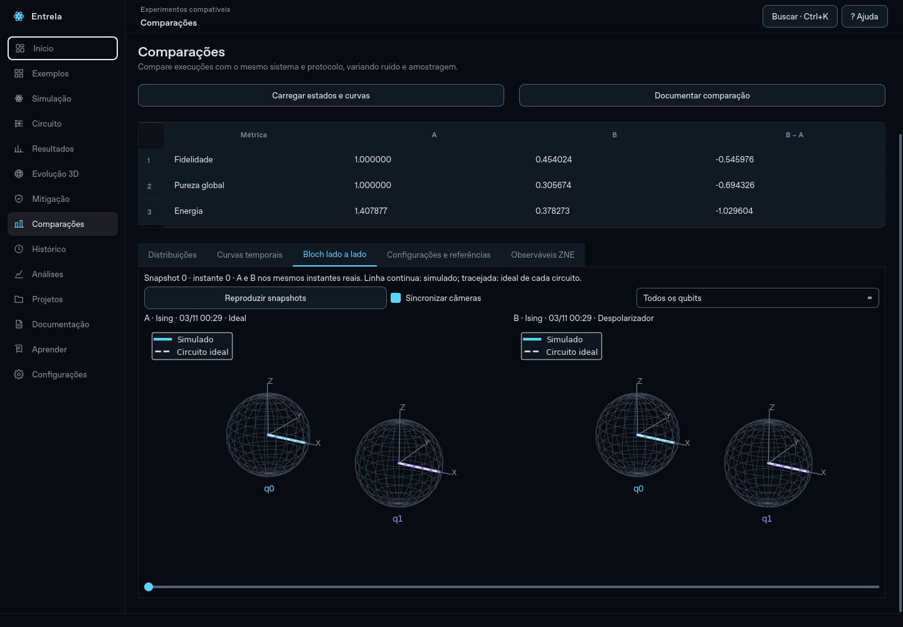
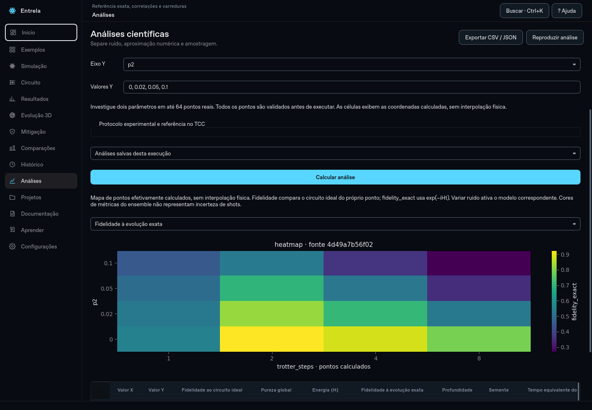
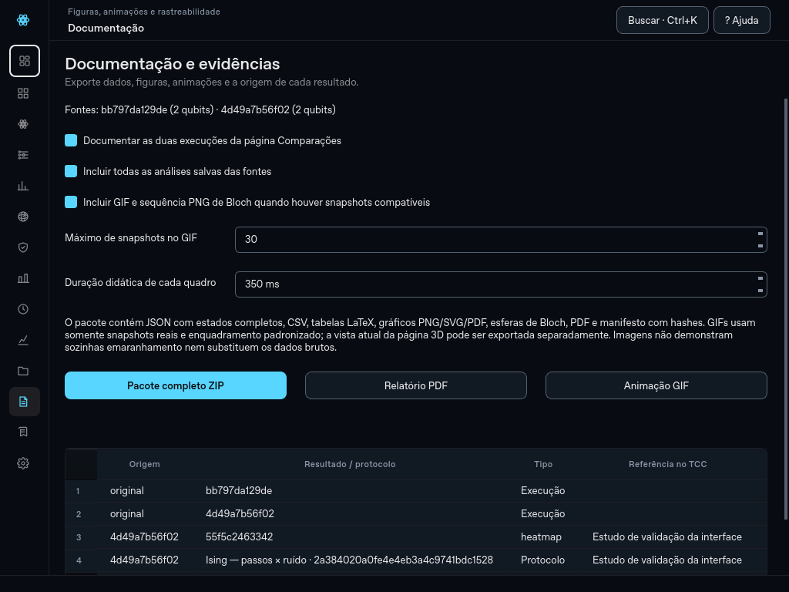
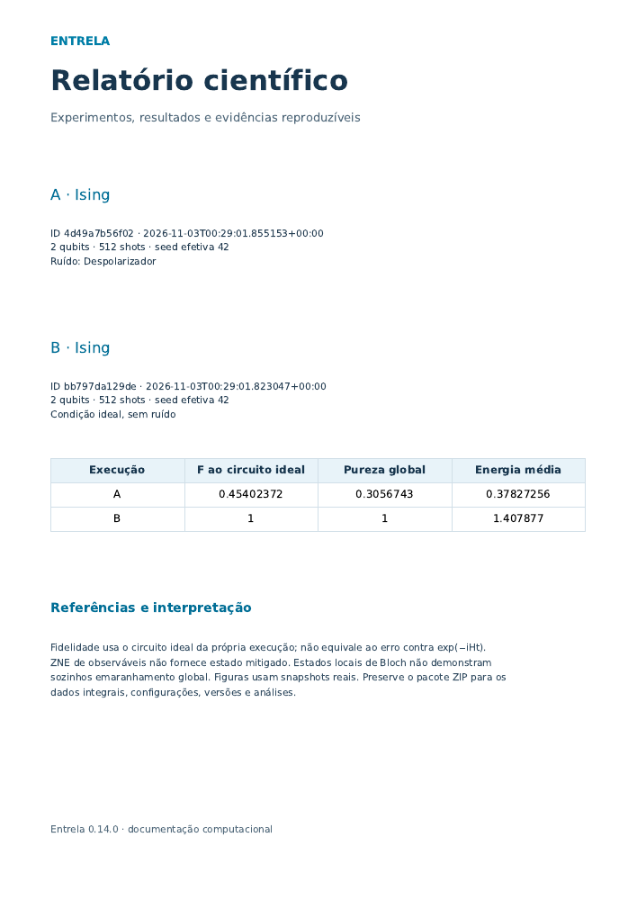

# Entrela 0.14 — protocolos, estudos e documentação científica

Evolução da versão 0.13 (`5bccd19`), na mesma branch **`evolucao_entrela`**. Os dados de validação e as imagens deste documento são ensaios do aplicativo; não substituem o protocolo nem os resultados do Capítulo 4 do TCC.

## Protocolos experimentais

Abra uma execução e entre em **Análises**. Escolha o tipo de estudo e os valores. Expanda **Protocolo experimental e referência no TCC** para registrar nome, pergunta, hipótese, controles/métricas e referência no texto, por exemplo “Tabela 5 · Figura 4.2”. **Salvar nova revisão** grava um identificador próprio, configuração da fonte, seed efetiva, opções e versões. Novas revisões não substituem as antigas.

Selecione uma revisão e use **Carregar protocolo** para reabrir a fonte e as opções. **Calcular análise** gera outra evidência, preservando o plano. A análise guarda uma cópia dos campos e das opções executadas. Se campos, fonte ou opções mudam sem salvar nova revisão, o contexto registra uma derivação do plano anterior, sem atribuir as mudanças à revisão imutável. **Reproduzir análise** usa o protocolo e as opções da evidência reaberta, mesmo que o formulário tenha sido editado depois.

Protocolos ficam em `.protocols/`; análises, em `.analyses/<fonte>/`. O registro científico original não é reescrito. A configuração da fonte precisa continuar disponível para carregar o protocolo no aplicativo; o pacote exportado também contém as configurações completas para reprodução externa.



## Mapas de calor

Em **Análises → Mapa de calor de dois parâmetros**, escolha os eixos e valores separados por vírgula, usando ponto decimal. São suportados passos Trotter, p1, p2, T₁, T₂, J e h. Use no máximo oito valores distintos por eixo, totalizando até 64 pontos.

Todos os pontos são validados antes da primeira simulação. Variar p1/p2 ativa despolarização; variar T₁/T₂ ativa o modelo térmico. Não se misturam parâmetros dos dois modelos no mesmo mapa. Um mapa térmico precisa satisfazer T₂ ≤ 2T₁ em todas as combinações; os dois tempos são aplicados juntos antes de validar. Circuitos livres aceitam parâmetros de ruído, sem parâmetros de Hamiltoniano/Trotter.

Cada ponto guarda configuração efetiva, contagens, seed, versões, duração e métricas. A referência de fidelidade ao circuito ideal muda junto com o próprio ponto. Para Hamiltonianos, `fidelity_exact` também compara com exp(−iHt) no mesmo tempo final. O mapa abre nessa referência exata quando disponível; circuitos livres usam fidelidade ao circuito ideal. Células representam coordenadas efetivamente calculadas, com espaçamento categórico e rótulos explícitos, sem interpolação física.



## Estabilidade da ZNE

Em **Estabilidade da ZNE: viés e variância**, informe conjuntos como `1,3,5; 1,3,7`, quantidades de shots como `256,1024`, qubit de Z e número de repetições. Cada grupo usa sementes distintas e registra todas as contagens, seeds, custos e ajustes. Ajustes linear/quadrático reutilizam as mesmas medições da respectiva repetição.

- **Viés empírico:** média das estimativas menos a referência ideal do circuito compilado U/CX.
- **Variância amostral:** denominador n−1 entre repetições independentes do estimador.
- **MSE/RMSE:** média empírica dos erros quadráticos e sua raiz; não se confunde essa média com variância amostral.
- **Erro padrão da média:** desvio amostral dividido por √n.
- **Erro padrão previsto:** aproximação por amostragem propagada pelo ajuste; não cobre viés de extrapolação ou do modelo.
- **Fora do intervalo físico:** contagem de estimativas além de [-1,1], tolerando 10⁻¹⁰ de arredondamento; valores não são truncados.

Três pontos em ajuste quadrático têm zero grau de liberdade residual. Sementes distintas avaliam flutuação de contagens/estimadores, não incerteza das métricas determinísticas de uma matriz densidade de ensemble. Não se produz uma fidelidade de estado mitigado a partir de ZNE de um observável.

Limites: até três conjuntos distintos de 3–5 fatores ímpares entre 1 e 9, incluindo 1; até três quantidades de shots; 2–10 repetições; até 60 conjuntos adquiridos por estudo; até 100.000 portas por circuito folded e 1.000.000 shots por configuração de aquisição. A referência ideal e o ruído usam a mesma compilação U/CX, sem otimização após folding.

## Comparação com orçamento equivalente

Este estudo compara **sem mitigação**, **ZNE linear** e **ZNE quadrática** com o mesmo total de shots por método e repetição. O baseline recebe N shots; ZNE distribui N entre os fatores, incluindo o resto da divisão. Por exemplo, N=13 em três fatores resulta em 5/4/4 shots.

Os ajustes compartilham a aquisição ZNE. O custo real não é a soma ingênua das três linhas: baseline e conjunto ZNE adquirem, juntos, 2N shots por repetição. As opções, contagens e seeds permitem conferir isso. Tempos médios de aquisição e ajuste polinomial por método e custo total do grupo ficam registrados. Setup compartilhado e estatísticas agregadas não integram o tempo de ajuste. Orçamento igual de shots não iguala profundidade, tempo, nem quantidade de portas. O estudo compara estimativas de Z; o benchmark da versão 0.13 continua disponível para verificação de paridade e métricas de estados físicos.

## Comparar execuções lado a lado

Em **Comparações**, escolha A e B. Resumos e histogramas continuam leves. Clique em **Carregar estados e curvas** para abrir e validar os registros completos e calcular as séries fora da thread gráfica.

- **Distribuições:** sobreposição ou dois painéis, normalizados pelo número observado de medições.
- **Curvas temporais:** fidelidade ao circuito ideal de cada execução, pureza global e energia quando existe Hamiltoniano.
- **Bloch lado a lado:** cenas A/B, câmeras sincronizáveis, foco por qubit e slider comum. Reprodução didática para no fim e pausa ao sair da página.
- **Configurações e referências:** parâmetros de ambas as fontes e resumo da mitigação, preservando os IDs.
- **Observáveis ZNE:** estimativas e erros padrão antes/depois do ajuste; baseline é o fator 1 compilado do próprio ZNE, sem misturar silenciosamente a base da simulação fonte.

A comparação exige mesmo sistema, circuito e protocolo de evolução, permitindo variar ruído e amostragem. Não há alinhamento automático de experimentos fisicamente diferentes. A sincronização temporal exige snapshots nos mesmos instantes; se faltarem estados intermediários ou as grades diferirem, o visualizador mostra os estados finais e desativa o slider. Não interpola estados nem inventa trajetórias. Registros ZNE continuam exibindo estados da simulação de origem.

## Central de documentação

A nova página **Documentação** permite exportar a execução selecionada ou as duas fontes carregadas em Comparações. O quadro de evidências relaciona fonte → análise → protocolo/referência no TCC. Duplo clique numa análise reabre sua fonte e seus dados. Reprodução de uma simulação também registra o identificador de origem; os vínculos de importação e de ZNE permanecem explícitos.



### Pacote ZIP

O pacote inclui:

- JSON integral de cada execução, com estados complexos, operações, configuração, versões, seeds e metadados;
- CSV científico e coordenadas/purezas locais de Bloch por snapshot e qubit;
- histogramas, curvas temporais, estados finais de Bloch e prévias dos circuitos em **PNG, SVG e PDF**;
- estudos em JSON, CSV + manifesto, **tabelas LaTeX** e gráficos PNG/SVG/PDF;
- relatório PDF com fontes, métricas, figuras, tabelas, configurações, hipóteses e limitações;
- revisões de protocolos das fontes selecionadas;
- GIF e sequência PNG dos snapshots selecionados quando disponíveis;
- `manifest.json`, com IDs, referências no TCC, associação entre estudos/arquivos e hashes SHA-256;
- `README.md`, com instruções de reprodução e distinção entre simulação fonte e análise de mitigação.

Anotações e protocolos de outras fontes não são incluídos. A opção padrão inclui todas as análises salvas das fontes e a análise atual dessas fontes, inclusive se ainda não pôde ser salva; pode ser desmarcada. O pacote é preparado em diretório temporário e substitui o destino somente ao terminar. Cancelar ou falhar preserva o arquivo de destino anterior e os registros científicos.

### Imagens e animações

Na página **Evolução 3D**, **Exportar vista PNG / SVG / PDF** preserva a vista atual, incluindo câmera e snapshot. Um `.metadata.json` adjacente registra fonte, câmera, foco, opções visuais, configuração, seed e versões.

**Documentação → Animação GIF** usa enquadramento padronizado, com legenda de fonte, qubit, snapshot e instante. Usa de 2 a 80 quadros, selecionados uniformemente entre snapshots reais, incluindo início e fim. Não cria quadros intermediários nem fecha a trajetória em um ciclo físico. Reprodução única; duração didática de 100–3000 ms por quadro. IDs, índices, instantes, configurações, versões e seeds ficam no comentário JSON embutido no GIF. GIF comparativo exige a mesma grade temporal.

No pacote ZIP, as imagens PNG dos quadros acompanham o GIF e são identificadas no manifesto. Se os snapshots não permitem animação, a ausência é registrada em `omissions`; estados/figuras finais e dados brutos continuam disponíveis. Prévia de circuito é limitada às primeiras 80 operações; os parâmetros e operações integrais ficam no JSON. Imagens de Bloch são estados reduzidos locais e não demonstram sozinhas emaranhamento global.



### Tabelas e gráficos individuais

O ZIP acessado por **Resultados → JSON / pacote** também usa a exportação completa, em segundo plano.

Em **Análises → Exportar análise / figura**, escolha CSV, JSON, LaTeX ou figura PNG/SVG/PDF. A figura individual corresponde à métrica selecionada. LaTeX usa `longtable`, escapa textos externos e associa cada linha à posição no JSON; preserve os dados de precisão integral. Recomenda-se compilação UTF-8, por exemplo LuaLaTeX, para símbolos e textos científicos. Cada tabela LaTeX tem um identificador `tab:entrela-<id>` para referências no texto. Tabelas de apresentação selecionam até oito colunas; CSV/JSON preservam todas.

## Escopo e validação

Estudos, comparação de estados e documentação completa usam workers canceláveis, sem manipular widgets fora da thread gráfica. A central de documentação usa Matplotlib/Pillow para PDF/GIF e não depende de um serviço web ou encoder de vídeo. Qt continua sendo usado para a interface e para o relatório HTML/PDF existente.

Não foram adicionados novos métodos de reconstrução de estado, execução em hardware, comparação automática de protocolos incompatíveis, MP4 ou interpolação de estados. Abertura individual de experimentos e leitura da lista de evidências ainda podem ocupar a interface em bibliotecas muito grandes; carregamento dos estados de comparação e geração dos pacotes são assíncronos.

Validação inclui predição analítica de despolarização, alocação exata de orçamento com resto, estatísticas calculadas independentemente, repetição das contagens pelas seeds registradas, preservação das fontes, protocolos imutáveis, GIF real com metadados/índices, arquivos vetoriais/PDF reais e hashes dos artefatos listados no manifesto. Os testes da interface cobrem protocolo → execução → reabertura → reprodução, câmeras/slider sincronizados, ausência de snapshots, exportação sem bloquear o loop Qt e captura da vista atual. O teste gráfico offscreen no Linux não substitui ensaio físico no Windows, touchpad, projetor ou leitor de tela.

Resultados desta entrega:

- **304 testes passaram**, sem falhas ou skips, no Linux/Python 3.12.
- Fluxo completo nas 14 páginas: simulações com/sem ruído, com/sem snapshots, persistência, tutorial, ZNE, importação/exportação e reabertura.
- Wheel 0.14 construído e exercitado fora do checkout, incluindo assets, janela Qt, motor científico e persistência.
- Sondagem 3D em escala 150%, com 1, 2 e 6 qubits: layout, câmera, zoom, foco, reprodução, abas e navegação.
- Inspeção de comparação, mapa de calor e documentação em 1440×1000 e 1024×768; PDF renderizado e conferido visualmente.
- Dependências conferidas com `pip check`; sem problemas encontrados.

```bash
QT_QPA_PLATFORM=offscreen python -m pytest -q -p no:cacheprovider
QT_QPA_PLATFORM=offscreen python scripts/cloud_smoke.py
QT_QPA_PLATFORM=offscreen QT_SCALE_FACTOR=1.5 python scripts/bloch_smoke.py
python -m pip wheel --no-deps . -w work/dist
python scripts/package_smoke.py work/dist/entrela-0.14.0-py3-none-any.whl
```
