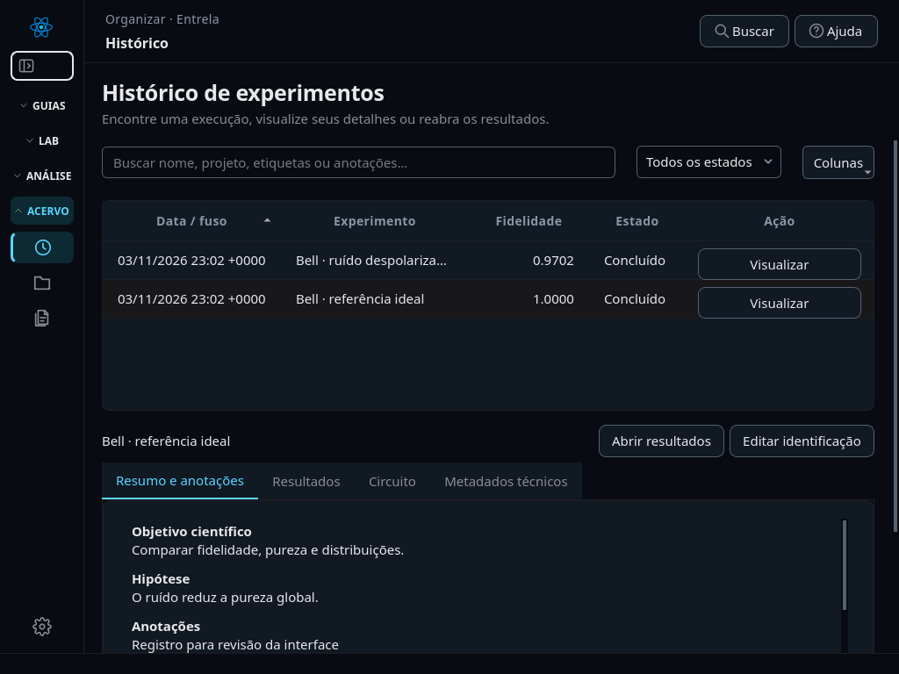
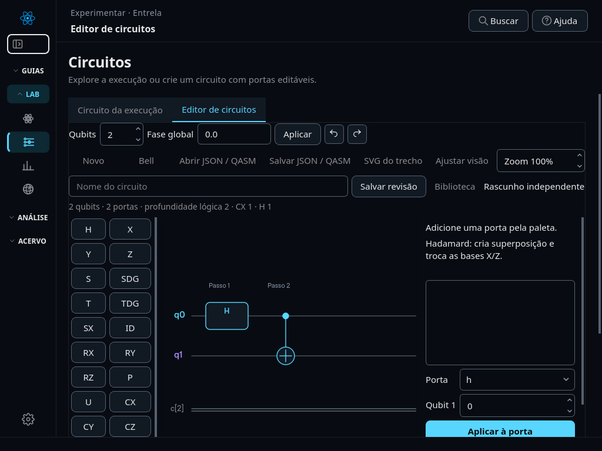

# Entrela 0.16 — plataforma científica e experiência de uso

Esta versão parte da [auditoria do código 0.15](auditoria-plataforma-0.16.md). Preserva os experimentos, modelos de ruído, ZNE e formatos anteriores. Os dados usados na validação do software não constituem resultados do capítulo experimental do TCC.

## Fluxo de trabalho

1. Em **Configurar experimento**, informe nome e descrição. O nome vazio gera uma identificação legível; a chave técnica permanece interna. Execute para obter dados reais do simulador.
2. No **Histórico**, use **Visualizar**. O resumo é imediato; estados e detalhes completos são carregados em segundo plano. **Abrir resultados** seleciona o experimento na aplicação; **Editar identificação** abre seu caderno de pesquisa. Pesquisa, status, paginação, ordenação e **Colunas** ajudam a organizar registros.
3. No caderno, registre objetivo, hipótese, metodologia, categorias, etiquetas e notas posteriores. Essas informações ficam separadas do JSON científico; editar uma hipótese não recalcula nem altera os resultados.
4. Em **Comparações**, selecione duas execuções compatíveis. As abas **Curvas temporais** e **Bloch lado a lado** carregam os estados ao serem selecionadas. Experimentos sem snapshots explicam essa ausência. **Observáveis ZNE** só apresenta estimativas realmente registradas.
5. Em **Documentação**, selecione relatório completo/resumido e suas seções. Exporte PDF, GIF ou ZIP com dados, figuras e metadados. A vista atual de Bloch também exporta câmera, foco e snapshot em um arquivo de metadados adjacente.

Os IDs continuam nos arquivos exportados, nas referências entre registros e em metadados técnicos. São necessários à rastreabilidade, mas não servem como nome principal na interface.

## Inspeção da interface

Capturas em 1024 × 768 com dados de validação do software, não resultados do TCC.

## Editor e aprendizagem

O editor preserva importação/exportação JSON, OpenQASM 2 e SVG, desfazer/refazer, portas parametrizadas e execução Qiskit/Aer. Agora inclui biblioteca nomeada com revisões preservadas, recuperação, duplicação, multisseleção e copiar/colar. Editar e reaplicar um ângulo sem alterá-lo preserva seu valor binário. Matrizes no inspetor são arredondadas para leitura; os parâmetros e documentos mantêm a precisão numérica.

O circuito executado completo fica em `config.circuit`. Quando a origem é uma revisão da biblioteca, seus metadados registram nome, revisão e se o rascunho foi modificado. A biblioteca não substitui o documento científico de cada execução.

**Aprender e consultar** reúne 15 conceitos com definição, intuição, matemática, exemplos, exercícios e referências bibliográficas. Há demonstrações executáveis pequenas, incluindo Bell, Deutsch–Jozsa balanceado de um bit e Grover de dois qubits. Shor completo, correção de erros operacional e teletransporte com feed-forward são conteúdos conceituais; não são apresentados como protocolos implementados.

## Aparência e acessibilidade

O botão **Buscar** mantém a pesquisa; o atalho Ctrl+K foi removido. A navegação compacta mostra nomes curtos dos grupos e tooltips dos itens. As transições de grupos são reversíveis e respeitam redução de movimento.

Preferências persistem tema claro/escuro/automático, cor de destaque, escala de texto, densidade, contraste, redução de movimento, aviso de conclusão e resolução de imagens. As opções de comparação e conteúdo do relatório também são restauradas. O aviso de conclusão usa o mecanismo de atenção do Qt; sua apresentação depende do sistema operacional.

O ícone Entrela é distribuído em SVG, PNG e ICO multirresolução. A splash usa um orçamento de 3000 ms contado desde sua exibição, sem acrescentar atraso depois da inicialização. Se a thread gráfica permanecer bloqueada por mais de três segundos ao iniciar, o sistema só consegue fechá-la quando essa inicialização terminar.

## Documentos e integridade científica

Todas as páginas dos relatórios e dos PDFs de figuras do pacote têm A4 retrato: 210 × 297 mm. Cabeçalho, rodapé e numeração seguem uma composição comum. Texto e artistas vetoriais permanecem vetoriais; imagens rasterizadas usam 300 DPI por padrão, configuráveis nas preferências. GIF usa dimensões em pixels e tempo didático por quadro, sem interpolar estados inexistentes.

Os estados são validados antes de calcular Bloch. Energia rejeita observáveis não hermitianos, dimensões incompatíveis e valores não finitos. A fidelidade é a convenção quadrática de Uhlmann usada pelo Qiskit. Pureza global e vetor de Bloch local não são a mesma propriedade: um Bell globalmente puro tem estados locais mistos.

O ruído térmico continua sendo um modelo educativo com duração assumida por porta, não uma calibração de hardware real. ZNE extrapola observáveis e não reconstrói um estado mitigado; não se atribui fidelidade de estado à estimativa extrapolada. A linha do tempo distingue snapshots após portas lógicas em circuitos livres de snapshots ao fim de camadas Trotter. Comparações com eixos temporais incompatíveis são rejeitadas.

## Escopo avaliado e próximos incrementos

| Recurso | Situação e condição para evoluir |
|---|---|
| Métricas, ruído, referência exata, entropia, negatividade e benchmarks | Existentes, preservados e cobertos por regressão. Usar um protocolo para produzir os dados do TCC. |
| Estados, matrizes de portas, biblioteca e documentação | Integrados à evolução atual. Visualização dedicada da matriz densidade é um próximo incremento útil. |
| Tomografia de estados/processos | Exige bases de medição, estimação física e análise de incerteza próprias; não implementada nesta entrega. |
| Correção de erros operacional | Exige síndromes, medições intermediárias e controle clássico; a explicação conceitual não substitui sua implementação. |
| Hardware IBM e comparação entre simuladores | Exigem credenciais, gestão de jobs e separação explícita entre dados físicos e simulados. |
| Notebooks científicos | Integração possível a partir de JSON/CSV, mas execução de código arbitrário não foi adicionada à interface. |
| Escalabilidade além de seis qubits | Depende do custo exponencial de matrizes densidade e da memória de snapshots; os limites existentes continuam explícitos. |

## Validação

Validação local em Linux/Python 3.12: **361 testes passaram** na suíte completa. Também passaram `pip check`, o teste de fluxo pelas 14 páginas com simulações reais do Aer e o teste do wheel 0.16 instalado em diretório isolado, incluindo assets, estados e persistência. PDFs foram renderizados para inspeção, e as interfaces foram capturadas em 1024 × 768 e 1440 × 900, incluindo fonte ampliada e tema claro.

Os testes cobrem resultados analíticos, persistência, threads, exportações e regressões da interface. A inspeção visual usa Qt offscreen em diferentes tamanhos; isso não equivale a testar fisicamente a barra de tarefas do Windows, leitores de tela ou todas as escalas de monitor. A CI mantém os ambientes Linux e Windows para validação adicional após o envio da branch.
