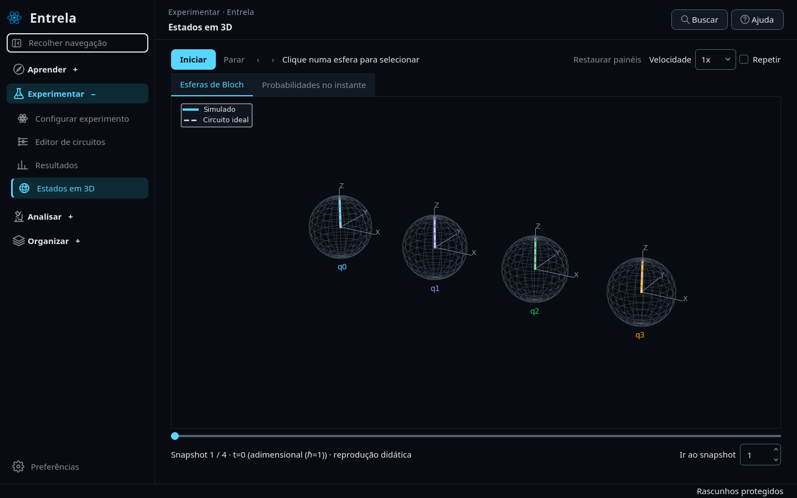

# Entrela 0.17 — recuperação e reprodução de estudos

Primeira etapa da consolidação proposta após a revisão da versão 0.16: proteger trabalho em edição, explicitar referências científicas e fechar o ciclo de importação/reprodução. Preserva os experimentos existentes e não transforma simulações em dados de hardware.

## Foco e disposição em 3D

- Um clique na esfera isolada desfaz o foco e mostra todos os qubits.
- **Restaurar câmera** também remove o foco e a seleção, além de restaurar zoom, posição e orientação.
- O botão de foco muda para **Mostrar todos os qubits** durante o isolamento. O seletor, os painéis e as comparações permanecem sincronizados.
- Até quatro qubits ficam na mesma linha; cinco e seis usam uma segunda linha. A distribuição também vale para os painéis de informações e figuras independentes de Bloch. PDFs podem dividir os qubits em páginas menores para preservar legibilidade.
- Desfocar e mudar a câmera não alteram o estado quântico, os resultados ou os snapshots.

## Recuperação de trabalho

O estado editável é gravado automaticamente após uma breve pausa na edição e sincronizado ao fechar. O indicador inferior informa **Salvando rascunhos**, **Rascunhos protegidos** ou uma falha de gravação. A proteção inclui:

- Circuito, nome, descrição, fase e parâmetros ainda não aplicados.
- Configuração, seed e modelo de ruído do editor.
- Nome, descrição e controles do formulário de simulação, inclusive texto temporariamente inválido.
- Anotações por execução e campos do protocolo em elaboração.
- Nome do modelo pessoal ainda não salvo.

Texto inválido é recuperado como texto, sem executar silenciosamente uma configuração anterior. Anotações recuperadas só integram o caderno formal quando o usuário escolhe **Salvar identificação e observações**. Revisões nomeadas do circuito continuam explícitas.

Trocar a configuração também considera alterações de nome e descrição, mesmo quando os parâmetros não mudaram. Executar pelo editor preserva o formulário de outro estudo: nomes e descrições do circuito são associados à sua própria execução.

Em **Editor de circuitos → Biblioteca → Recuperar rascunho anterior**, é possível recuperar até dez estados anteriores do editor. Eles sobrevivem ao fechamento; substituir um circuito por um novo não impede recuperar seu rascunho anterior.

O arquivo de recuperação usa gravação por substituição e mantém uma cópia válida anterior. Arquivos danificados são preservados separadamente antes de uma nova gravação. Se houver falha ao proteger as alterações, fechar exige uma escolha explícita entre cancelar ou descartar a recuperação pendente.

Essa cópia protege rascunhos locais. Não é um backup completo de todos os projetos, preferências e versões da instalação, nem um mecanismo de coordenação entre várias instâncias escrevendo no mesmo workspace.

## Importação de um estudo

1. Exporte **Documentação → Pacote completo ZIP**. O pacote compacto de Resultados também inclui manifesto verificável quando contém anotações ou análise.
2. Na outra instalação, use **Documentação → Importar estudo ZIP**, ou **Buscar → Importar experimento ou estudo**.
3. O importador verifica tamanho, índice de arquivos, conteúdo e hashes SHA-256 antes de instalar qualquer registro. Nomes inseguros e caminhos externos são rejeitados.
4. Execuções, análises, protocolos e anotações recebem identificadores locais novos, com os vínculos internos ajustados. Resultados numéricos, contagens, configurações e datas de execução permanecem preservados.
5. O ZIP original e o mapeamento de identificadores ficam guardados em `.imports`. Erros durante a instalação removem os novos arquivos dessa tentativa; dados existentes não são substituídos.

O trabalho de leitura, hashing e preparação ocorre em segundo plano e pode ser cancelado antes da instalação. O arquivo original é copiado para a preparação antes de ser verificado, evitando misturar conteúdos se o arquivo externo mudar durante o processo.

Hashes verificam integridade em relação ao manifesto do pacote; não constituem assinatura da autoria. Pacotes antigos sem manifesto verificável devem ser abertos pelo JSON do experimento. O importador restaura o estudo e seu circuito executado, não todas as preferências ou versões da biblioteca de circuitos da instalação de origem.

## Verificação da reprodução

**Reexecutar** usa a seed efetiva registrada e cria outra execução. A nova execução inclui um diagnóstico com configuração, tolerância absoluta, diferença máxima entre elementos das matrizes densidade e diferenças de fidelidade, pureza e energia quando disponíveis. Matrizes densidade tornam a comparação de estados puros insensível à fase global.

Igualdade de contagens é registrada separadamente. Uma reprodução pode ser numericamente compatível e produzir amostras diferentes em outra versão ou plataforma. O aplicativo informa as diferenças de ambiente disponíveis; não promete identidade entre plataformas.

**Reproduzir ZNE** verifica amostras, estimativas, ajuste e erro padrão da extrapolação. Não usa a fidelidade herdada da fonte para declarar que a mitigação foi reproduzida. O ambiente de cálculo da mitigação é registrado separadamente do ambiente da simulação original.

## Referências e modelo térmico

Resultados identifica a fidelidade ao circuito sem ruído. A explicação distingue essa referência da evolução exata e separa métricas do ensemble de estimadores obtidos por shots. Mudar a seed não estima, por si só, incerteza da fidelidade de um ensemble calculado por matriz densidade.

O modelo térmico permite configurar **duração de porta 1q** e **duração de porta 2q**, em ns, tanto no formulário quanto no editor. T₁ e T₂ continuam em µs. As durações assumidas entram no canal de relaxação, nos metadados e na configuração reproduzível; não representam uma calibração de hardware nem o tempo adimensional do Hamiltoniano.

Arquivos anteriores sem essas durações usam o padrão histórico de 50 ns para ambas. Protocolos antigos são normalizados em memória, sem reescrever os arquivos originais.

## Comparação de Trotter

Em **Comparações**, o critério **Convergência · variar passos ou ordem de Trotter** permite diferentes profundidades e ordens, mantendo sistema e tempo final iguais. As curvas de fidelidade desse modo usam a evolução exata como referência. Isso evita concluir que dois circuitos ideais têm a mesma precisão apenas porque ambos têm fidelidade 1 ao próprio circuito sem ruído.

Grades temporais diferentes são exibidas sem interpolação: Bloch mostra os estados finais e a sincronização por snapshot fica desativada. A referência escolhida acompanha gráficos exportados, PDF, manifesto e importação do estudo.

## Validação e continuidade

**389 testes passaram** na suíte completa em Linux/Python 3.12. Também passaram `pip check`, o fluxo real pelas 14 páginas com persistência e ZNE e o teste do wheel 0.17 em diretório isolado, incluindo recuperação do circuito após reiniciar. O pacote foi comparado aos fontes da entrega.

A validação cobre clique Qt real, foco/reset, quatro qubits por linha, recuperação de entradas inválidas, rascunhos anteriores, falha de gravação, hashes divergentes, caminhos inseguros, cancelamento, rollback da importação e exportação/importação reais. Canais térmicos são comparados com decaimento analítico; reprodução de estado e de ZNE são verificadas separadamente.

A inspeção visual usa Qt offscreen. A validação física de escala, instalação e barra de tarefas no Windows continua necessária.

Próximas etapas da revisão geral: área unificada do estudo, visualização de matriz densidade e correlações, perfil de desempenho com históricos grandes, divisão adicional do controlador principal, backup completo do workspace e distribuição nativa no Windows. Esta entrega inicia a consolidação; não declara todas essas etapas concluídas.
