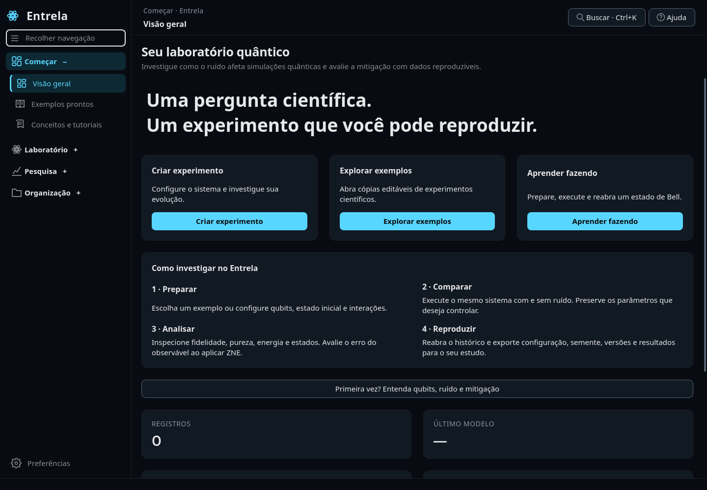
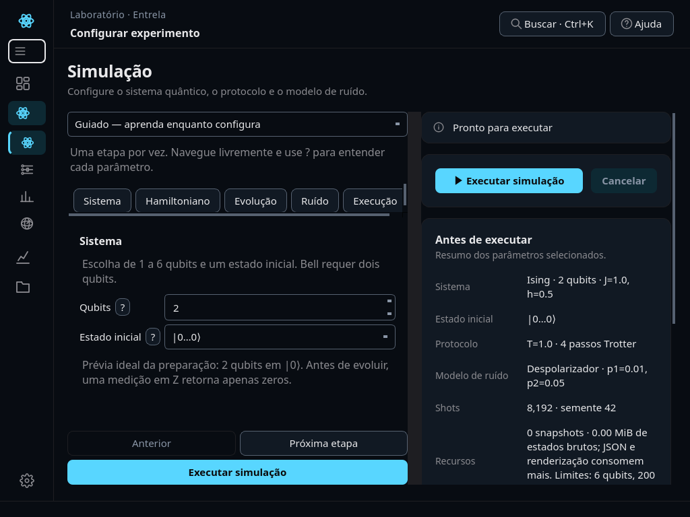
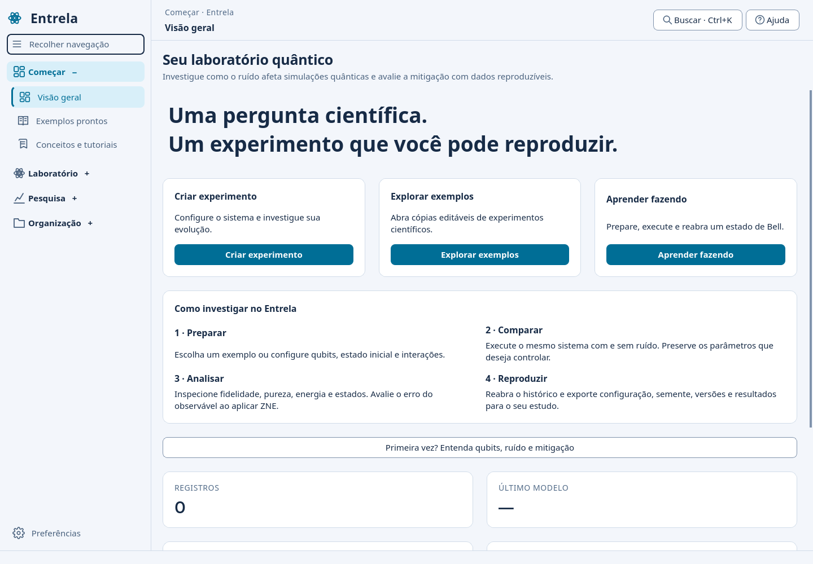

# Entrela 0.15 — interface mais legível e navegação agrupada

Entrega na branch `evolucao_entrela`, a partir da 0.14. A organização visual e a navegação foram revisadas; os parâmetros científicos, registros e formatos de dados continuam preservados.

## Encontrar as ferramentas

| Grupo | Páginas |
|---|---|
| Começar | Visão geral, Exemplos prontos, Conceitos e tutoriais |
| Laboratório | Configurar experimento, Editor de circuitos, Resultados, Estados em 3D |
| Pesquisa | Estudos científicos, Mitigação de ruído, Comparar execuções |
| Organização | Histórico, Projetos e modelos, Exportar e documentar |

Preferências ficam no rodapé. Clique no título de um grupo para expandir/recolher suas páginas; somente um grupo fica aberto por vez. Expandir um grupo não troca a página. Navegar por paleta de comandos, tutorial ou links internos abre automaticamente o grupo da página escolhida. O grupo atual e a página selecionada têm realces distintos.

A navegação tem rolagem própria, sem exigir que todas as ferramentas apareçam simultaneamente. O botão do menu alterna barra completa e compacta. Em janelas menores, a barra se recolhe automaticamente; é possível expandi-la manualmente. Mesmo compacta, mantém os agrupadores, ícones maiores, tooltips e nomes acessíveis para teclado/leitores de tela. O cabeçalho mostra grupo e nome da ferramenta; a busca reconhece os novos rótulos e os nomes anteriores.

## Legibilidade e acabamento

- Fonte padrão aumentada de 13 para 15 px; textos auxiliares também ganharam tamanho.
- O antigo padrão de 13 px migra uma única vez para 15 px. Outras escolhas existentes são mantidas. Após a migração, um tamanho escolhido manualmente continua respeitado, inclusive 13 px.
- Preferências permite ajustar o tamanho entre 11 e 20 px e alternar temas claro/escuro.
- Áreas de navegação com pelo menos 44 px de altura, ícones de 22–24 px e barra completa mais larga.
- Ícones desenhados a partir dos caminhos SVG no DPR solicitado pelo Qt; não se ampliam miniaturas rasterizadas para os botões. Comparações, exemplos e documentação têm símbolos mais distintos.
- A fonte usa uma família realmente instalada: Inter, Segoe UI, Noto Sans ou DejaVu Sans, com fallback do sistema.
- Cabeçalho com busca/ajuda vetoriais, títulos mais claros e trilha do grupo atual.
- Formulário e resumo mantidos lado a lado em 1024×768 quando há largura útil suficiente. Em espaço menor, empilham com alturas mínimas e rolagem para não comprimir os campos.

## Validação

307 testes passaram no Linux/Python 3.12. Os novos casos verificam expansão sem navegação involuntária, acesso direto a páginas em outro grupo, busca pelos novos nomes, navegação compacta e migração/persistência do tamanho de fonte. Também foram exercitados o fluxo completo das 14 páginas e o pacote instalado fora do checkout.

Capturas reais em 1440×1000 e 1024×768, com temas claro/escuro. O teste gráfico offscreen não substitui o ensaio no Windows físico e na escala de tela usada pelo usuário.

Atualização: trocar para `evolucao_entrela`, executar `git pull --ff-only` e reiniciar o aplicativo. Dados, protocolos e experimentos não precisam ser apagados.
