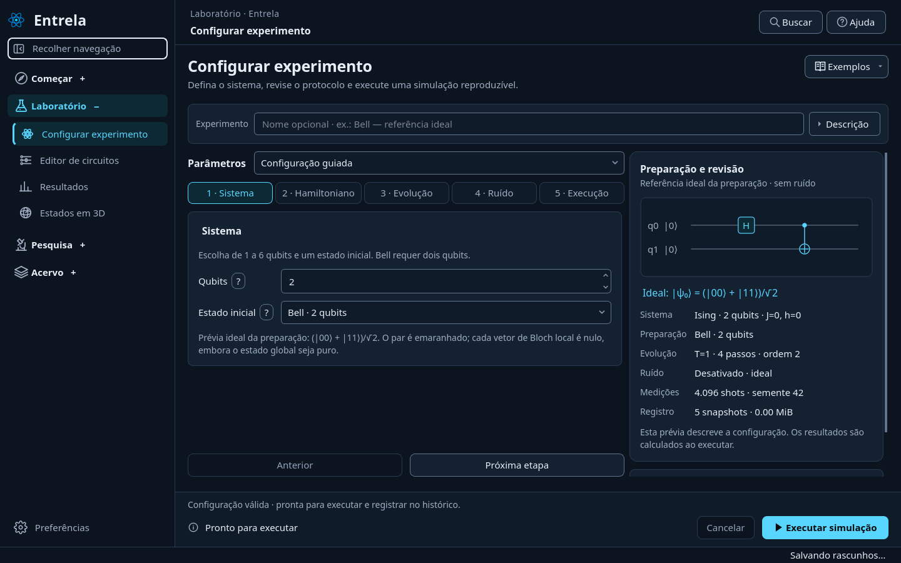
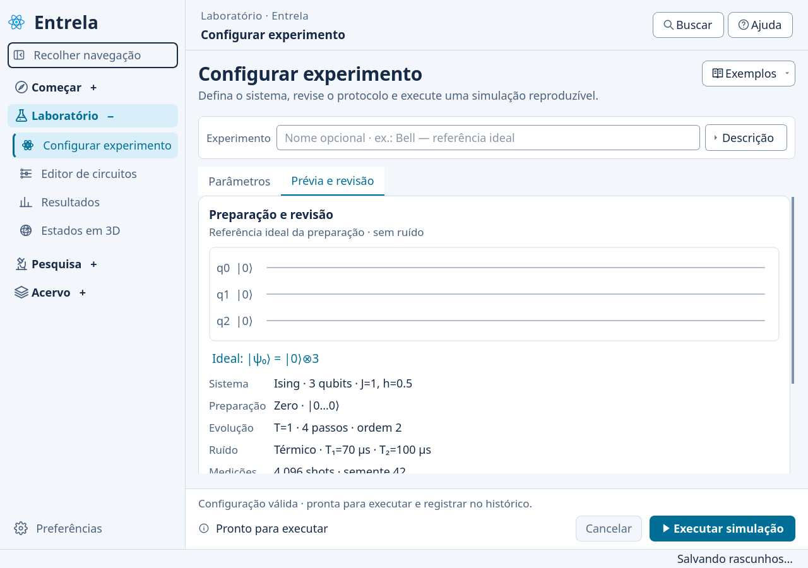
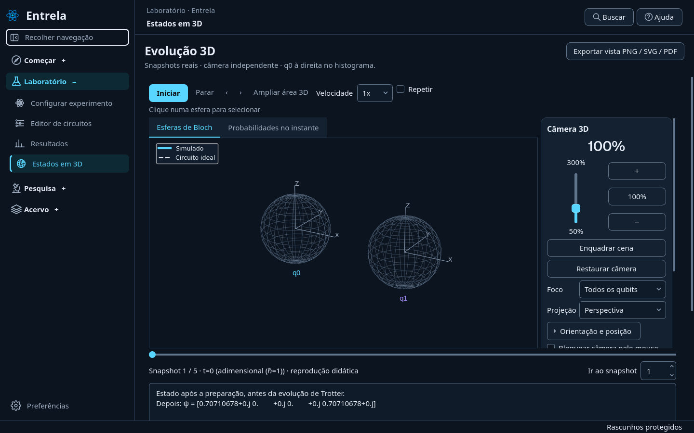

# Interface do laboratório — 0.18

## Diagnóstico anterior às alterações

A revisão partiu da versão 0.17, preservando o aplicativo desktop em PySide6, as páginas existentes, o controlador de execução assíncrona, o repositório de experimentos e os cálculos em Qiskit/Aer. Foram inspecionados configuração guiada/avançada, navegação, tema e personalização, recuperação de rascunhos, componentes compartilhados, resultados e testes de interface.

Na simulação, identificação, campos e revisão ocupavam blocos sem uma sequência clara. As ações de execução competiam com o resumo; formulários longos e painéis com rolagem exigiam alternar a atenção entre áreas distantes. Todos os parâmetros de ruído eram exibidos juntos, inclusive os inativos. O resumo mostrava `h` mesmo em modelos que não o utilizam. Botões de cabeçalhos e navegação podiam cortar textos com fontes maiores.

Os principais riscos da reorganização eram recriar campos e perder precisão, alterar parâmetros ao mudar de modo, esconder resultados existentes, perder o vínculo entre ajuda/tutorial e etapas e interromper a recuperação de rascunhos. Os mesmos controles e contratos de execução foram mantidos; o esquema dos experimentos e os algoritmos científicos não foram alterados.

## Configurar, revisar e executar

O módulo reúne quatro áreas:

1. **Identificação**: nome opcional e descrição expansível. Objetivos, hipóteses e metodologia continuam no caderno do experimento.
2. **Parâmetros**: cinco etapas guiadas ou as mesmas seções recolhíveis, com um resumo dos valores no cabeçalho. Em pouco espaço, a seleção de etapa usa uma lista com os cinco nomes.
3. **Preparação e revisão**: diagrama vetorial da preparação ideal e resumo do sistema, evolução, ruído, medições e armazenamento estimado.
4. **Execução**: barra fixa com validação, progresso, cancelamento e execução. Após selecionar ou executar um experimento, atalhos abrem seus resultados e os snapshots 3D disponíveis.

Em janelas menores ou com fontes maiores, parâmetros e revisão passam a ocupar duas abas. Os widgets são transferidos entre as apresentações; seus valores, precisão e conexões são preservados. Não é preciso executar novamente ao redimensionar a janela.

O menu **Exemplos** reutiliza as configurações da galeria. Carregar um exemplo não executa a simulação. A confirmação já existente protege parâmetros, nome e descrição editados antes de uma substituição.

## Parâmetros e integridade científica

O formulário mostra `p₁/p₂` para despolarização e `T₁/T₂` e durações de porta para o canal térmico. Desativar o ruído oculta esses campos. Alternar modelos conserva os valores digitados. Unidades distinguem µs, ns e tempo adimensional com ℏ=1; ajuda e tooltips descrevem a finalidade e os padrões dos campos.

Cada Hamiltoniano apresenta a expressão correspondente à implementação existente. O campo `h` aparece apenas em Ising e Custom; Custom continua sendo a compatibilidade com Ising. No XXZ, o coeficiente ZZ continua fixo em 0,5J. As condições de contorno e as durações térmicas permanecem as já suportadas pelo simulador.

A prévia desenha somente a estrutura conhecida da preparação ideal: fios em zero, H para superposição e H/CX para Bell. Ela **não executa o circuito**, não prevê o estado ruidoso e não constitui resultado. O ruído pode atuar também nas portas de preparação durante a execução. Fidelidade, pureza, energia e ZNE continuam calculados e interpretados pelos módulos científicos existentes.

Uma configuração inválida desativa a execução e explica o ajuste necessário. **Revisar parâmetros** leva à etapa correspondente, inclusive quando a aba de revisão está aberta. O botão de execução continua disponível fora da rolagem dos parâmetros.

## Consistência e personalização

As superfícies adotam tons de azul acinzentado com o ciano Entrela como destaque padrão. Estados, foco, campos, divisores discretos e hierarquia tipográfica usam o tema compartilhado. Os temas claro/escuro/automático, outras cores de destaque, contraste, tamanho de fonte, densidade e redução de movimento continuam em Preferências.

As seções recolhíveis respeitam redução de movimento. Modo, etapa, seções abertas e apresentação da descrição e da ajuda de interpretação são recuperados com o rascunho. Nenhuma dessas preferências modifica uma execução científica já salva.

A navegação se organiza em **Começar**, **Laboratório**, **Pesquisa** e **Acervo**, com os mesmos destinos. O menu recolhido mantém rótulos de grupo e tooltips completos. Sua largura acompanha a tipografia para evitar cortes. Cabeçalhos de páginas podem distribuir ações em mais de uma linha; títulos e subtítulos de cartões quebram linha quando necessário.

As barras de ferramentas do 3D e do circuito também distribuem controles em mais de uma linha, mantendo rótulos junto dos seus campos. O painel da câmera acompanha a tipografia; as abas da visualização podem abreviar títulos sem ampliar a página além da janela. O circuito executado apresenta o nome do experimento e conserva o identificador técnico no tooltip.

## Validação

**398 testes passaram** na suíte completa em Linux/Python 3.12. Os novos casos cobrem preservação de precisão ao alternar modelos e redimensionar, configuração inválida e navegação até a correção, proteção de rascunhos ao carregar exemplos, recuperação das seções abertas, redução de movimento e acesso aos controles com fonte ampliada.

Também passaram `pip check`, o fluxo real pelas 14 páginas (simulação ideal/ruidosa com e sem snapshots, histórico, ZNE, tutorial, exportação/importação e reabertura) e a abertura do wheel 0.18 fora do checkout. Os 98 módulos Python empacotados foram comparados aos fontes. A inspeção visual cobriu temas claro e escuro, fontes de 15 a 24 px e janelas de 1024 × 768 até 1920 × 1080.

A inspeção visual utiliza Qt offscreen em Linux. Escala física, renderização de fontes e comportamento nativo no Windows precisam de conferência nessa plataforma. Esta validação não substitui a execução da matriz de CI no Windows.

Esta entrega concentra-se na organização e na experiência das funcionalidades existentes. Não adiciona novos métodos científicos nem transforma a prévia estrutural em uma simulação física.

## Capturas da aplicação

Configuração guiada e preparação ideal de Bell:

Revisão no tema claro com fonte ampliada:

Visualização de snapshots de uma simulação de Bell executada localmente:

