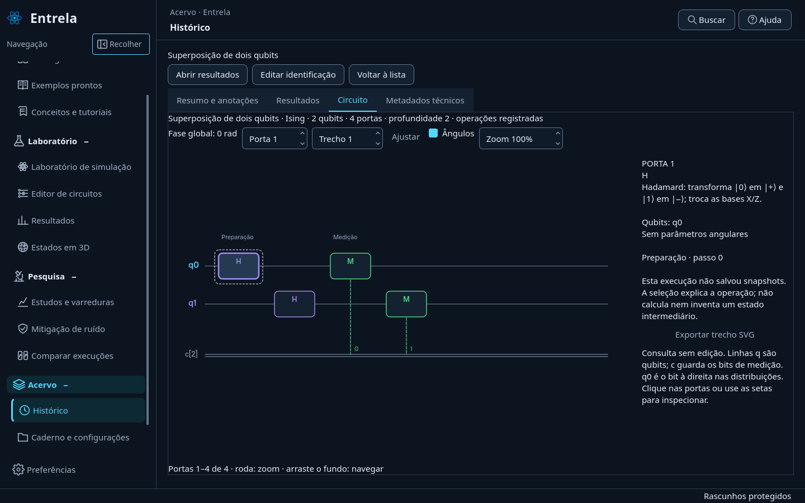
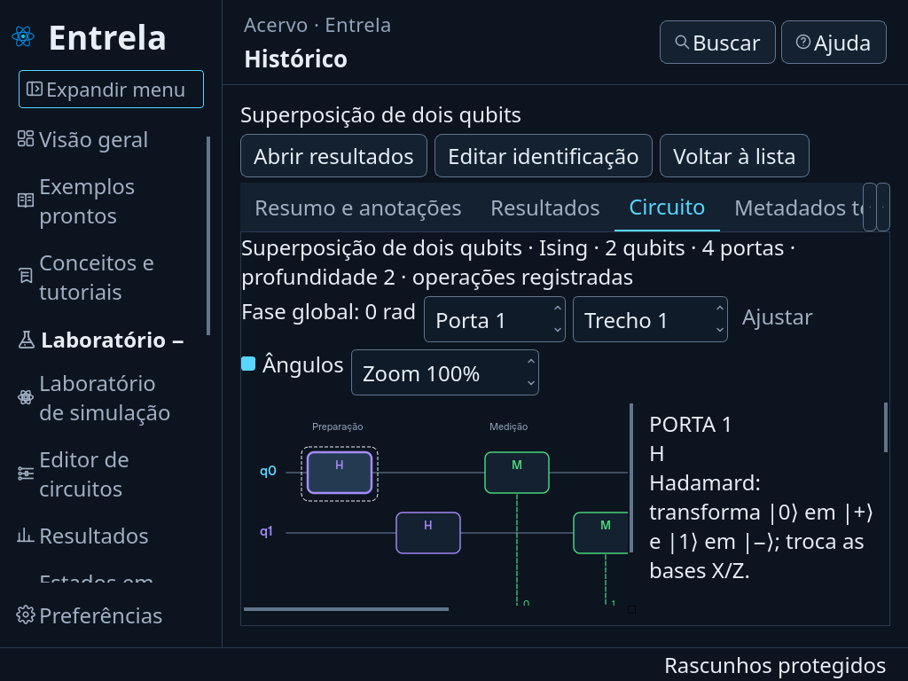
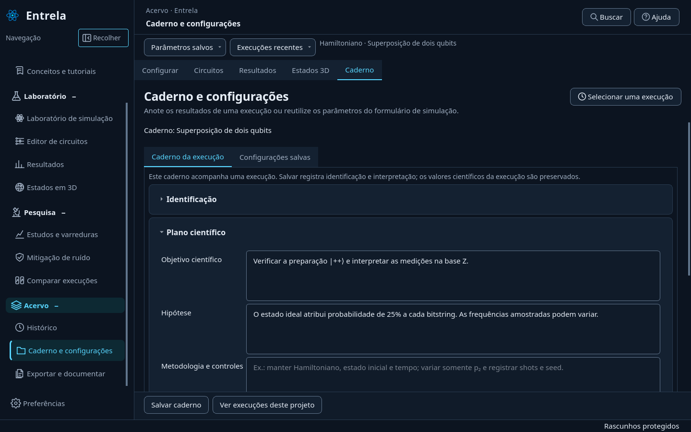

# Entrela 0.21 — consulta de circuitos e organização do caderno

Esta etapa atende ao pedido de substituir o circuito ASCII do histórico e avança nos itens 16, 17 e 18 do [plano de evolução](plano-evolucao.md). As simulações, as métricas e os formatos científicos existentes foram preservados.

## Circuito no histórico

Em **Histórico → Visualizar → Circuito**, o registro é apresentado pelo mesmo componente gráfico usado em **Circuitos → Circuito da execução**. A consulta do histórico não contém editor, não permite movimentar/remover portas e não muda a execução aberta no laboratório.

- Clique em uma operação ou use as setas para consultar significado, qubits, parâmetros em radianos e origem na preparação, evolução ou medição.
- O seletor de operação e os trechos de até 100 operações permitem consultar circuitos longos.
- A roda do mouse e o campo de zoom ampliam o desenho; arrastar o fundo navega pelo circuito. **Ajustar** enquadra o trecho.
- **Exportar trecho SVG** preserva o desenho como vetor.
- **Ampliar detalhes** oculta temporariamente a lista e o cabeçalho da página. **Voltar à lista** restaura a navegação e a seleção.

As linhas q representam qubits; c é o registro clássico de medição. q0 corresponde ao bit à direita nas distribuições. As explicações de medição não afirmam que um estado condicionado foi salvo. Quando não há snapshots, a interface informa que não há estados intermediários disponíveis.

Para as portas de preparação, o snapshot indicado corresponde ao fim da preparação completa, antes da evolução por Hamiltoniano. A seleção de uma porta não implica que exista um estado salvo imediatamente depois dela.

### Registros antigos e evidência

Operações registradas têm precedência sobre qualquer reconstrução. Uma fase global ausente continua indicada como não registrada; não é inferida de um circuito novo.

Para arquivos antigos sem operações, o circuito é reconstruído pela configuração e pelas bibliotecas atuais, com aviso explícito. Essa reconstrução não comprova a decomposição histórica. Uma execução com falha e sem operações não recebe um circuito reconstruído como evidência.

O texto ASCII permanece no arquivo original quando já existe, mas não é utilizado como representação visual nem interpretado para gerar resultados. A listagem continua leve: o diagrama aguarda a leitura dos detalhes completos, e respostas atrasadas de outra seleção são ignoradas.

## Caderno com menos níveis

As abas internas de identificação, plano e anotações foram substituídas por seções expansíveis no mesmo caderno. A separação entre o caderno da execução e as configurações do formulário foi mantida.

**Salvar caderno** e **Ver execuções deste projeto** permanecem fora da rolagem. Abertura das seções e escolha entre caderno/configurações são persistidas nas preferências. Rascunhos, identificação da execução e nomes das configurações continuam no mecanismo existente de recuperação; uma mudança visual não altera o registro científico.

## Figuras consistentes

Histogramas do histórico, dos resultados, das comparações e dos relatórios compartilham o renderizador. Gráficos dos oito tipos de estudo e curvas de fidelidade/pureza/energia também usam as mesmas rotinas científicas, com estilos próprios da tela ou do documento.

Os rótulos e unidades ficam em um módulo independente de Qt. Tempo de evolução e índice de porta são diferenciados. Artefatos sem informação de unidade são identificados como tal. Varreduras agrupam cada semente em sua própria curva, e valores ausentes deixam lacunas em vez de conectar pontos sem suporte.

As comparações Trotter preservam as grades temporais independentes e a referência exata. O gráfico usa, no máximo, 101 snapshots reais por curva de métricas, com o mesmo limite de apresentação nos meios compartilhados. Os dados brutos e os controles de navegação dos estados preservam todos os snapshots disponíveis.

O exportador de figuras da tela mantém a seleção atual. Relatórios completos seguem seus perfis e podem apresentar conjuntos de séries diferentes; ampliar a escolha de séries nesses perfis permanece pendente. A cena 3D interativa conserva câmera e controles próprios; a representação científica de Bloch utiliza os mesmos vetores calculados pelas métricas.

## Validação e limites

Foram adicionados testes para consulta sem edição, seleção por clique/teclado, carregamento assíncrono, reconstrução identificada, fase ausente, registros com falha, trechos longos e SVG vetorial. O caderno é verificado com recuperação após reinício e com a preservação dos arquivos científicos.

A verificação visual utiliza Qt offscreen no Linux, incluindo 1024 × 768 com fontes de 15 e 24 px. Há testes geométricos para impedir sobreposição entre controles, diagrama e legenda. A validação nativa manual no Windows permanece pendente.

A execução prolongada da suíte revelou acúmulo de janelas Qt fechadas e atingiu o limite de memória do ambiente. A limpeza dos testes agora destrói as janelas explicitamente. Essa validação também identificou callbacks de layout que podiam acessar componentes já destruídos; os temporizadores do circuito, menu, editor, laboratório, parâmetros e câmera 3D agora pertencem aos respectivos componentes e são descartados com eles.

A suíte completa passou com **628 testes**. O pico de memória do processo foi de **1.149.760 KiB (aproximadamente 1,1 GiB)**, abaixo do limite de 8 GiB do ambiente. O teste do laboratório verifica as 14 páginas, simulações ideais/ruidosas com e sem snapshots, persistência, ZNE e tutorial. A verificação do wheel abre a aplicação em processo isolado e consulta o circuito gráfico, os estados, o backup e a recuperação dos dados.

Os logs desta entrega ficam em `work/validacao-021/` no ambiente de execução. Os próximos avanços científicos do P2 continuam separados desta entrega; preparação seguida de evolução exige um contrato de dados e validação próprios.
