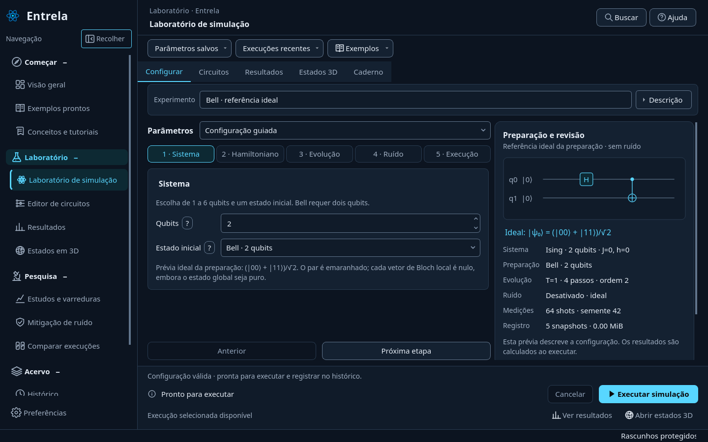
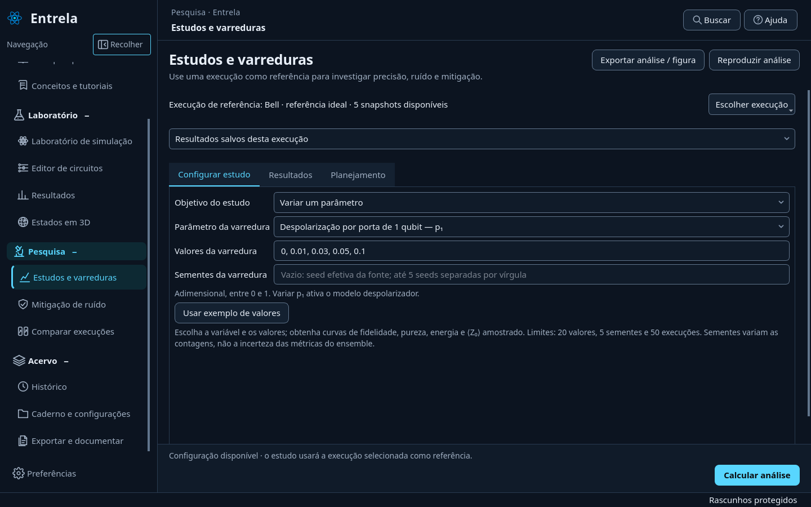
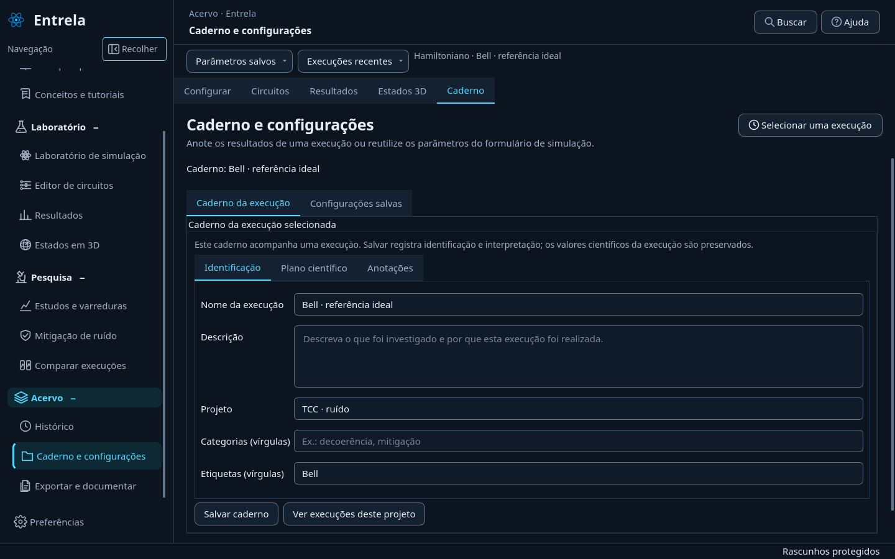
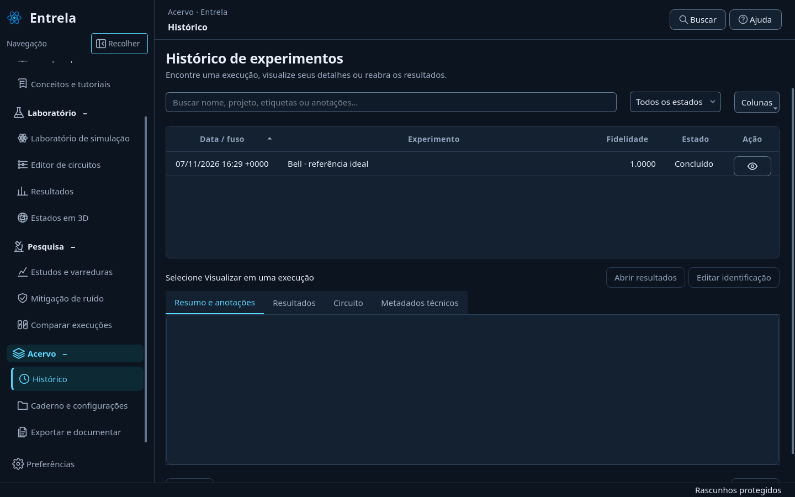

# Laboratório integrado e estudos claros — 0.19

## Fluxo de trabalho

O **Laboratório de simulação** reúne cinco abas sobre as mesmas páginas e os mesmos rascunhos que já existiam:

1. **Configurar**: evolução por Hamiltoniano, estado inicial, ruído, medições e semente.
2. **Circuitos**: inspeção do circuito executado e editor independente de portas, com modelos prontos e biblioteca de revisões.
3. **Resultados**: métricas, gráficos, dados e reprodutibilidade da execução selecionada; ações de salvar, reexecutar e exportar.
4. **Estados 3D**: snapshots efetivamente registrados, câmera e probabilidades. Uma execução sem snapshots informa a ausência dos estados.
5. **Caderno**: nome, objetivo, hipótese, interpretação e organização da execução; também dá acesso às configurações salvas.

Os itens existentes do menu continuam como atalhos para essas abas. Não há uma segunda cópia dos formulários, dos gráficos ou do motor científico. Ao concluir uma simulação, Resultados abre no próprio laboratório. Os rascunhos permanecem disponíveis ao voltar para Configurar ou Circuitos.

**Parâmetros salvos** carrega configurações do formulário Hamiltoniano e permite abrir sua área de gerenciamento. **Execuções recentes** reabre resultados salvos. Ambos usam as proteções de rascunho e de resultado não salvo; carregar parâmetros não executa nada. Nomes longos da execução têm contexto completo no tooltip.

O atalho Ctrl+Enter respeita o editor visível: no editor de portas, executa aquele circuito; em Configurar, executa o formulário Hamiltoniano. Na inspeção de um circuito executado, orienta abrir uma cópia editável. Nas abas de resultados/caderno, leva à revisão dos parâmetros antes de executar outra evolução.

## Execução selecionada e rascunhos

Resultados, estados 3D e caderno pertencem à execução selecionada. O formulário Hamiltoniano e o editor de portas são rascunhos independentes. Mudar de aba ou editar campos não reescreve os dados científicos já produzidos.

Abrir um resultado de circuito livre não carrega os campos Hamiltonianos e também não substitui seu nome, descrição ou vínculo com exemplo. O circuito em edição continua preservado. Para editar o circuito de um resultado, use a ação de criar uma cópia no editor.

Comparações lado a lado e exportações completas continuam disponíveis nos destinos existentes. A comparação trabalha com o par de fontes selecionado em seu próprio painel; não deve ser confundida com a execução que está aberta no laboratório.

## Estudos e varreduras

A área usa uma execução como fonte para investigar ruído, precisão da aproximação ou amostragem. O seletor de fontes abre uma execução recente sem precisar ir ao histórico e voltar. Os estudos mantêm suas etapas em **Configurar estudo**, **Resultados** e **Planejamento**, com cálculo, cancelamento e progresso na própria tela.

Cada tipo apresenta finalidade, requisitos, parâmetros e saída esperada. Os campos usam nomes e unidades legíveis; os identificadores científicos usados nos arquivos permanecem iguais. Exemplos de listas são específicos do parâmetro e só são aplicados por uma ação explícita, preservando o que já foi digitado.

Análise temporal exige snapshots. Convergência de Trotter exige evolução por Hamiltoniano. O campo h não participa de Heisenberg, XY ou XXZ; a interface explica as combinações que não produzem esse estudo. Os motivos de indisponibilidade aparecem antes de iniciar o worker.

Ao abrir uma análise salva, seu tipo e as opções recuperáveis são sincronizados. Evidências históricas sem todos os insumos de reprodução continuam visualizáveis e exportáveis; a reprodução fica indisponível com explicação. Artefatos inválidos são rejeitados antes de substituir a evidência anterior na interface.

Para circuitos livres, as coordenadas temporais são índices de portas lógicas, não tempo físico ou tempo Hamiltoniano. A tabela e o gráfico usam a unidade correspondente. ZNE continua extrapolando observáveis; não é apresentado um estado mitigado reconstruído.

## Caderno e configurações

O nome substitui **Projetos e modelos**, que sugeria um gerenciador de projetos não implementado. A página agora distingue:

| Recurso | O que guarda | Como usar |
| --- | --- | --- |
| Caderno da execução | Identificação, planejamento e interpretação vinculados a uma execução | Abra uma execução e salve suas anotações. |
| Projeto | Nome textual para agrupar execuções de um estudo | Use o mesmo nome e acesse a busca correspondente no histórico. |
| Configuração salva | Parâmetros do formulário Hamiltoniano | Dê um nome, salve os valores em edição e reutilize-os depois. Uma atualização de nome existente pede confirmação. |
| Circuito salvo | Portas, conexões, parâmetros e revisões | Use a biblioteca do editor de circuitos. |
| Rascunho | Trabalho ainda em edição, inclusive entradas incompletas | A recuperação automática existente continua separada dos resultados salvos. |

A origem dos parâmetros é exibida ao salvar uma configuração. Configurações de circuito livre não são aceitas como se pertencessem ao formulário Hamiltoniano. Registros internos inválidos da biblioteca geram diagnóstico, preservam o arquivo e desativam um caderno que não pode ser associado com segurança à nova fonte.

## Ação do histórico

**Visualizar** passa a ser um ícone vetorial de olho, sem texto visível. O tooltip e o nome acessível são “Visualizar”; a descrição acessível identifica o experimento. A ação tem foco visível, pode ser ativada pelo teclado e mantém o vínculo pelo identificador interno após ordenar ou paginar. O clique abre os detalhes do registro e não substitui silenciosamente a execução atual.

## Auditoria e validação

O [relatório de auditoria](auditoria-0.19.md) registra organização, dependências, problemas comprovados, limites e decisões. Não foram alteradas as fórmulas de simulação, métricas, ruído ou mitigação. A principal mudança de arquitetura é composição de páginas existentes, preservando seus sinais e controladores.

**509 testes passaram** na suíte completa. Após o ajuste final da rolagem por aba, os **19 testes focados de estudos e integração** também passaram. A cobertura inclui abertura de circuito sem misturar identidades de rascunhos, execução contextual, proteção ao carregar parâmetros, troca de fonte de estudos sem sair da tela, teclado/ordenação no histórico e rejeição de artefatos inválidos com a evidência anterior preservada.

Também passaram `pip check`, o fluxo pelos 14 destinos da navegação com simulações ideal/ruidosa, persistência, ZNE, tutorial, exportação/importação e reabertura, e o teste do wheel 0.19 fora da pasta do projeto. O pacote foi comparado aos fontes da entrega.

A validação ocorreu em Linux/Python 3.12, Qiskit 2.4.1, Aer 0.17.2 e PySide6 6.11.1. A conferência visual usa Qt offscreen, temas claro/escuro, fontes 15/24 px e janelas de 1024 × 768 a 1920 × 1080. Formulários e gráficos extensos podem exigir rolagem vertical. A aparência nativa no Windows precisa de conferência nessa plataforma.

## Capturas da aplicação

Configuração e revisão da preparação ideal no laboratório:

Configuração de uma varredura a partir da execução selecionada:

Caderno da execução e configurações salvas com finalidades distintas:

Histórico com ação de olho:

