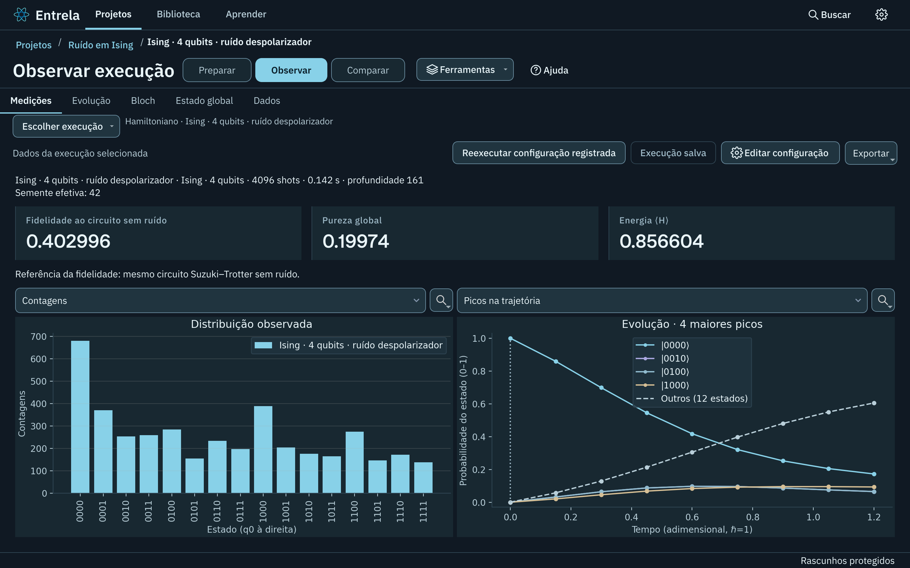
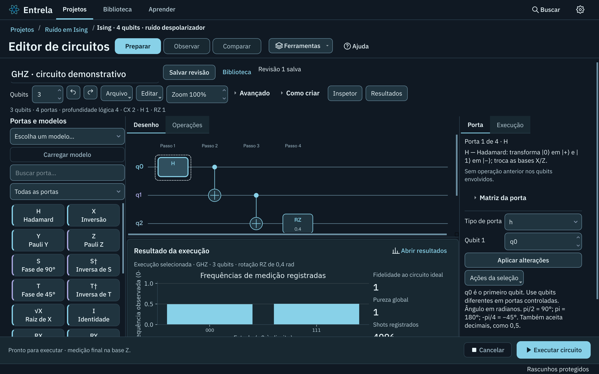
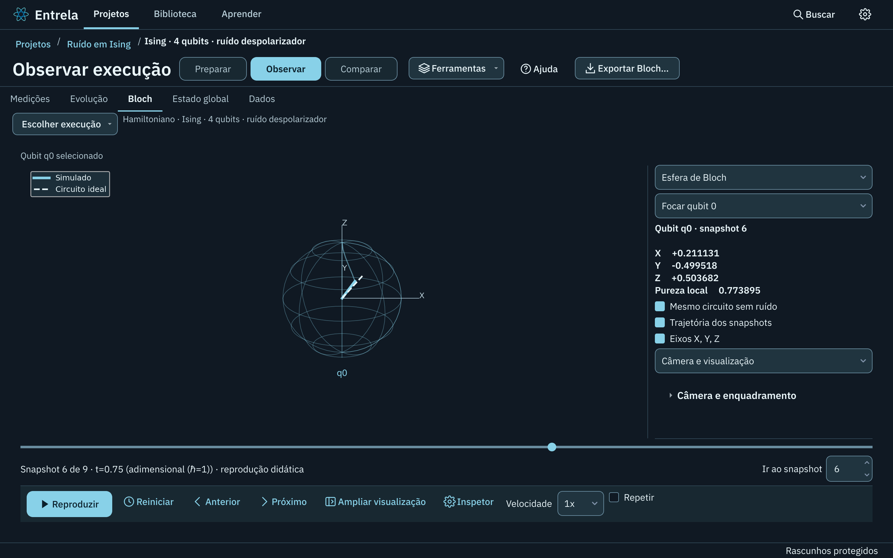
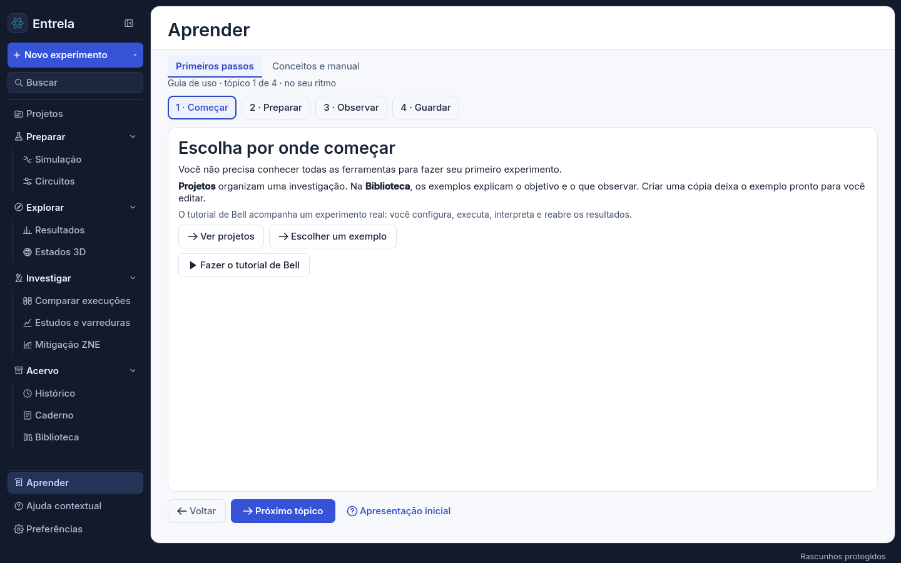

# Entrela

**Preparar. Observar. Comparar.**

O primeiro release do Entrela para Windows reúne um laboratório de simulação
quântica para construir circuitos, explorar estados e investigar como o ruído
afeta os resultados. Projetos, histórico e caderno ajudam a manter a investigação
organizada, da configuração até as figuras do relatório.

**[Baixar o instalador para Windows](https://github.com/ShardGem/Entrela/releases/download/v0.27.0/Entrela-0.27.0-windows-x64-setup.exe)** ·
[Baixar a versão portátil](https://github.com/ShardGem/Entrela/releases/download/v0.27.0/Entrela-0.27.0-windows-x64-portatil.zip)

Windows 10 21H2 ou posterior e Windows 11, em computadores x64.
**Não é necessário instalar Python.**

## Um experimento do seu jeito

Comece por um exemplo ou prepare uma configuração própria. O modo passo a passo
explica os campos no contexto; o modo avançado reúne os parâmetros para explorar
outras condições. Você pode definir o estado inicial, o Hamiltoniano, a evolução,
o modelo de ruído, o número de medições e a semente.

- Simulação ideal e ruidosa, com estados e parâmetros registrados por execução.
- Evolução por Hamiltonianos e aproximações de Suzuki–Trotter de segunda e quarta ordem.
- Modelos de ruído despolarizador e de relaxamento térmico.
- Monitor de tarefas com progresso e cancelamento acessível durante a navegação.

## Circuitos para construir e compreender

Monte o circuito com a paleta de portas ou abra um modelo como cópia editável.
O inspetor explica a operação selecionada e seus parâmetros, enquanto o desenho
mostra os qubits e a ordem das portas.

O editor oferece seleção, copiar e colar, desfazer e refazer, zoom, biblioteca
com revisões e importação ou exportação em **JSON e OpenQASM 2**. O circuito salvo
no histórico também pode ser explorado em modo de consulta.

## Veja os resultados acontecerem

Consulte o histograma de medições, acompanhe as probabilidades nos instantes
calculados e examine fidelidade, pureza e energia com suas referências.
Na esfera de Bloch, selecione um qubit, pause a reprodução ou avance um snapshot
por vez. O estado global tem seu próprio inspetor, com matriz densidade e métricas.

Para aprofundar a investigação, o Entrela reúne:

- Comparação de execuções por distribuições, curvas temporais, Bloch,
  configurações e métricas.
- Estudos de convergência, varreduras de parâmetros e mapas de calor.
- ZNE de observáveis, com medições por fator, ajuste, incertezas e referência ideal.
- Registro dos parâmetros efetivos e sementes para retomar e reproduzir estudos.

## Do resultado à documentação

Dê nome aos experimentos, organize-os em projetos e registre objetivos, hipóteses
e interpretações no caderno. O histórico mantém as execuções anteriores disponíveis
para consulta, comparação ou reutilização da configuração.

A exportação inclui **CSV, JSON, PNG, SVG, PDF, GIF, tabelas LaTeX e pacotes ZIP**,
conforme o conteúdo selecionado. Os relatórios científicos usam páginas A4 e
preservam a identificação das fontes. O backup reúne os dados do espaço de trabalho
para recuperação posterior.

## Um começo acompanhado, se você quiser

A apresentação inicial é opcional. Você pode conhecer o fluxo do aplicativo,
escolher um exemplo ou fazer o tutorial de Bell, que acompanha uma simulação
executada de verdade. O guia continua disponível em **Aprender → Primeiros passos**.

Os temas claro, grafite e azul, a escala do texto, a densidade e as preferências
de movimento permitem ajustar o ambiente ao seu jeito de trabalhar.

## Instalação

Abra o instalador e siga o assistente. Se preferir o portátil, extraia a pasta
inteira e abra **Entrela.exe**, mantendo os arquivos que o acompanham.

Os binários foram verificados no Windows, incluindo instalação, abertura fora
do código-fonte e desinstalação. Esta distribuição ainda não possui assinatura digital.
Os hashes e os recibos de verificação estão disponíveis nos anexos do release.

O Entrela realiza simulações clássicas de sistemas quânticos. As capturas são
demonstrações da interface. A ZNE estima observáveis e não garante melhoria para
qualquer configuração, nem produz um estado mitigado.

[Conhecer o projeto](https://github.com/ShardGem/Entrela) ·
[Ver todas as capturas](https://github.com/ShardGem/Entrela/blob/8f75354860ea625ec72dcc98a81f0f20a668eea9/docs/screenshots/0.27.0/README.md) ·
[Relatar um problema](https://github.com/ShardGem/Entrela/issues)
