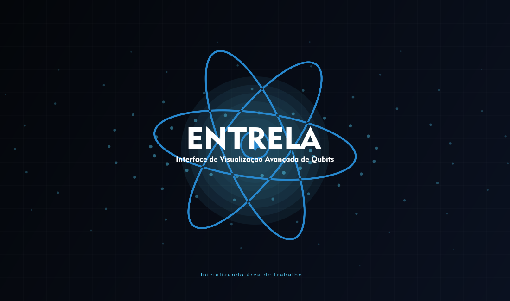
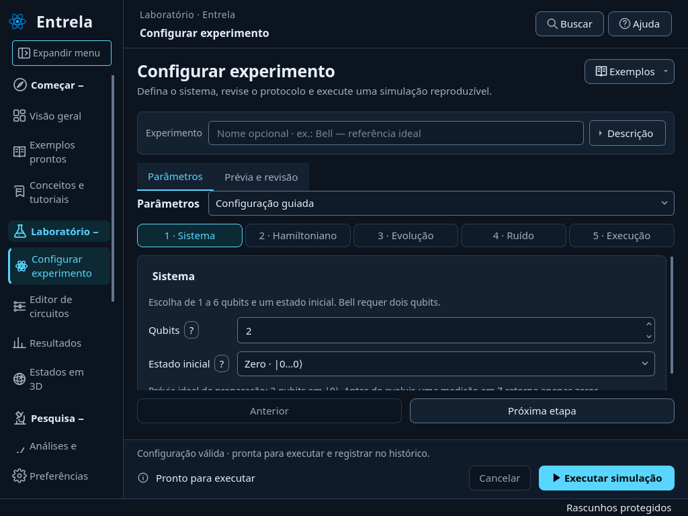
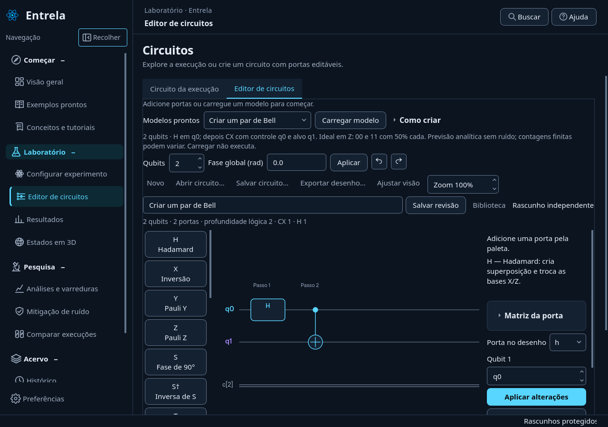

# Revisão da interface — 0.18.1

Esta revisão atende às correções de splash, navegação e criação de circuitos. Não altera a paleta global, o ícone do aplicativo, os algoritmos científicos nem os resultados salvos.

## Splash restaurada

A tela original anterior à substituição da versão 0.16 foi recuperada do histórico: composição de 1100 × 650, logo e texto dos arquivos originais e fundo de partículas. O desenho não foi substituído por outra proposta. A comparação de capturas no mesmo instante confirmou igualdade pixel a pixel com a versão histórica.

Foram preservados o orçamento de três segundos incluindo a inicialização, a preferência de redução de movimento e o encerramento dos timers e animações ao fechar.

## Navegação legível

Todos os grupos começam expandidos. Cada grupo abre e fecha independentemente; navegar para outra página não fecha os demais. Quando necessário, o grupo do destino é reaberto para mostrar a seleção.

O controle **Recolher / Expandir menu** apresenta ícone de painel e texto de ação. Fica na área de navegação, sem ocupar uma faixa semelhante a um campo de pesquisa.

O menu mais estreito conserva os nomes completos dos grupos e dos itens. Nomes longos podem ocupar duas linhas; os ícones complementam o texto. A rolagem do menu permite acessar todos os grupos quando não cabem na altura da janela. A opção correspondente em Preferências explica esse comportamento.

O cabeçalho da simulação considera o espaço real de seus textos e botão para acomodar o menu legível sem introduzir uma segunda rolagem desnecessária com fonte ampliada.

A reaplicação da aparência preserva a distribuição de colunas definida por cada página. Isso mantém espaço para o nome do experimento e para a ação Visualizar no histórico com o menu legível, sem alterar a tabela ou seus dados.

## Criar circuitos com orientação

As portas apresentam símbolo e nome. A ajuda contextual explica qubits, controle e alvo, radianos, fase global, medições, semente e ruído. **Como criar**, ao lado dos modelos, abre a leitura do desenho e a criação de Bell passo a passo; a matriz permanece disponível como informação avançada.

O seletor **Modelos prontos** oferece superposição, Bell, inversão, interferência e rotação do estado. Reutiliza os circuitos demonstrativos da biblioteca existente. Cada modelo informa a sequência de portas e uma previsão analítica ideal, identificada como tal.

Carregar um modelo cria uma cópia editável e não executa uma simulação. O usuário confirma a substituição de portas já existentes e pode desfazer a alteração. Semente, número de medições e parâmetros de ruído são mantidos. Salvar, importar, exportar e executar continuam disponíveis.

## Publicações

As novas mensagens de commit e descrições de atualizações usam português brasileiro, com redação simples e objetiva. A orientação está registrada em [AGENTS.md](../AGENTS.md). O histórico anterior não é reescrito.

## Validação

**414 testes passaram** na suíte completa em Linux/Python 3.12. A validação inclui o orçamento da splash, redução de movimento, encerramento das animações, grupos independentes, nomes visíveis nas duas larguras do menu, controles com fonte ampliada, confirmação e desfazer de modelos, preservação de parâmetros e comparação dos modelos com estados analíticos conhecidos.

Também passaram `pip check`, o fluxo pelas 14 páginas (simulações ideal/ruidosa com e sem snapshots, histórico, ZNE, tutorial, exportação/importação e reabertura) e a abertura do wheel 0.18.1 fora da pasta do projeto. Os 99 módulos Python e as imagens originais da splash no pacote foram comparados aos arquivos da entrega.

As capturas e verificações de layout utilizam Qt offscreen em Linux, com fontes de 15 e 24 px e janelas de 1024 × 768 até 1920 × 1080. Isso não substitui a conferência de aparência nativa no Windows.

## Capturas da aplicação

Splash original restaurada:

Menu estreito com nomes dos itens:

Editor com modelo Bell carregado para edição, sem executar:

